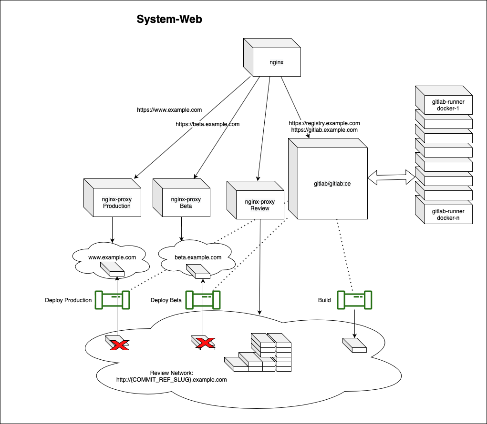

# The System — System Bootstrapper

**Bootstrap a development platform. Use it to build, test, and evolve its own next generation.**

> **Build your web projects. Not your infrastructure.**

## How it started: a developer's problem, a bigger idea

Imagine you're a solo front-end developer. You want to build and maintain your own web projects. You want the freedom of self-hosting on an affordable server—but you don't want to spend your evenings configuring services, chasing broken dependencies, or planning infrastructure upgrades.

That's the problem that led me to start **System Bootstrapper** in 2019. I wanted a development platform I could bootstrap for my own projects instead of repeatedly assembling and maintaining all the pieces by hand.

But getting the platform running was only half the problem. The platform itself would age and need upgrades. That led to a bigger question: **What if the platform could use its own development tools to build, test, and deliver its next generation?**

The idea grew from a convenient self-hosted setup into an open-source framework for **generation-by-generation renewal**. The running system should be able to develop a candidate successor, validate it as a complete platform, safely carry forward its persistent state, and let the validated successor repeat the process. A human developer—or, in the future, an optional AI agent—could propose changes through the same merge-request workflow.

The original use case is still simple: spend more time building web projects and less time maintaining the infrastructure behind them. But the underlying architecture could eventually support other kinds of infrastructure. **The self-renewal cycle is the project's vision, not a capability already delivered today.**

### Born before AI. Built to evolve.

The original architecture and core principles of System Bootstrapper were developed and implemented in **2019**, before AI coding agents became part of its development workflow.

Its architectural principle is simple: **the source code is the DNA; the running infrastructure is a reconstructible instance of it.** Infrastructure definitions can be reproduced from source, while persistent state is preserved independently. Rebuilding an existing installation requires its saved configuration and secrets as well as persistent service data, such as databases and repositories.

Today, AI expands the possibilities of that original architecture. Agents can help develop and validate changes to the source code from which future system generations are built. Fully autonomous generation-to-generation renewal remains a goal rather than an already delivered capability.

**AI did not create the architecture. It expands what the architecture can achieve.**

## Getting started

Choose a complete installation path in the [System Bootstrapper Handbook](docs/HANDBOOK.md):

- [Local Ubuntu / WSL2 with HTTP](docs/HANDBOOK.md#0-getting-started): prepare your local environment, start the platform and configure it through the Wizard.
- [Public Ubuntu root server with your own domain and HTTPS](docs/HANDBOOK.md#public-server-own-domain-and-https): prepare DNS and firewall rules, issue the first certificate with Certbot, configure the services and verify certificate renewal.

Each path covers checkout, host preparation, the first Sync login, configuration
and runner setup. Moving an existing installation to another host is covered
separately in [host replacement with a retained data volume](docs/HANDBOOK.md#replace-a-host-while-retaining-its-data-volume).
[Prepare-Host.md](Prepare-Host.md) covers installation and service-image selection;
[the persistence guide](docs/PERSISTENT_VOLUME.md) explains the required mounted
data filesystem. Domain names, storage and credentials belong to your deployment.

The platform combines GitLab Community Edition, its container registry,
GitLab Runner managers, NGINX routing, an authenticated Sync API and a React
configuration Wizard. Shell scripts and Docker Compose coordinate their lifecycle.
A successful Wizard **Push** imports configuration and automatically restarts the
platform; **Fetch** reads the saved settings. Runner scale controls independent
managers in a shared GitLab runner pool, rather than a separate GitLab runner
registration for every container.

Application starters cover Angular, React and general web projects. The
[project guide](docs/PROJECT_BOOTSTRAP_GUIDE.md) explains private repository creation,
editable source, CI and application environments. The Wizard is itself registered
as a managed project: explicit [source initialization](docs/WIZARD_SOURCE.md),
[build configuration](docs/WIZARD_BUILD.md),
[Review/Beta environments](project-bootstrap/wizard-environments/README.md) and
[controlled Production promotion](project-bootstrap/wizard-production/README.md)
provide separate, inspectable operations. Building or merging source alone does
not replace the running management interface.

An operator with an existing Wizard development repository can instead adopt
[one source-primary Wizard project](project-bootstrap/wizard-source-primary/README.md)
for source, native checks, candidate environments and production images. This
keeps development and delivery in one repository without importing over user
changes. The legacy managed initialization remains available for other setups.

An operator can also select GitLab as the development and issue-tracking
platform with an optional [GitHub code mirror](docs/GITLAB_GITHUB_BACKUP.md).
That guide covers source-history mapping, reviewed merges, tracker migration
and verification. The mirror forwards merged code; the existing persistent
volume and recovery contract retain GitLab's service state.

Persistent service data lives beneath the configured mounted `PERSISTENT_DIR`.
The Wizard exports configuration separately; [Harvest/Seed](docs/RECOVERY_CONTRACT.md)
creates and restores completed service-data snapshots. A retained live data
filesystem can be reused without first restoring a Seed.

[Component and integration checks](tests/README.md) are supplied in the repository.
The candidate harness runs disposable platform instances with isolated resources;
its lifecycle checks are distinct from promoting an entire successor platform.
The [evolution chapter](docs/HANDBOOK.md#5-evolving-a-running-system) describes
the bounded workflow for a reviewed successor: committed tools, isolated migration
checks, accepted source/image evidence and deliberate promotion. A particular
version transition is accepted only after its required tests and post-deployment
checks pass. Open-ended recursive self-improvement remains a design goal.

## Why this project exists

Setting up a development platform involves more than installing GitLab or starting a few containers. GitLab, its runners, the registry, application environments, networks, domains, and reverse proxies must work together.

System Bootstrapper encodes that setup in a repository. Docker containers provide the services, while scripts and configuration connect them into a development platform. The intended entry point is an Ubuntu host with the required access and resources; the bootstrap process should turn that host into a usable environment with minimal manual setup.

But installation is only the beginning. Dependencies change, services evolve, and a once-working environment can become difficult to update. The central purpose of this project is to make that renewal a normal, testable development workflow.

## Vision: automated recursive self-improvement

The System Cube also records a theoretical possibility for modular
communication. The `$` opening in its ASCII signature, reflected in port `8071`,
symbolizes a future opening to the outside world for introducing a seed and
communicating with other bootstrapper instances. This broader opening has not
yet been developed into a working interface. In the intended model, systems
contained within a Cube would communicate according to the same principle:
each system could expose an interface to its surroundings and contain other
communicating systems, allowing recursive composition.

This is an architectural possibility. The existing sync API does not implement
this broader communication model;
inter-bootstrapper and internal-system communication under a common model still
need to be specified and demonstrated. The port itself does not establish that
protocol or guarantee continuous connectivity.

The architecture should eventually support a feedback loop: identify a possible improvement, produce a candidate change, build and evaluate it, promote a validated improvement, and repeat from the improved system. The recursive aspect is that the system being improved also supplies the machinery for the next improvement cycle; that machinery can itself evolve.

Rebuilding or replacing a generation alone does not demonstrate improvement. A convincing demonstration needs explicit objectives and evaluation criteria that show what improved and whether required behavior was preserved. Changes use the GitLab merge-request workflow, and each supported transition needs explicit migration evidence and a deliberate promotion. The [handbook](docs/HANDBOOK.md#5-evolving-a-running-system) documents that bounded cycle. Automatically selecting arbitrary improvements and promoting them recursively remains the long-term vision, not a delivered autonomous capability.

The running platform should host its own source code and execute the pipelines that build its next version.

A merge request should be able to start a separate candidate platform from its branch. That candidate should represent the platform itself—including the relevant GitLab, runner, registry, network, and proxy configuration—rather than only a sample application deployed on top of it.

The intended cycle is:

1. **Bootstrap generation A.** Create an initial working platform on an Ubuntu host.
2. **Develop generation B using A.** Store and change the platform's own code through the GitLab workflow provided by the running platform.
3. **Create a review platform.** A GitLab Runner executes a pipeline that starts the candidate container landscape for the merge request.
4. **Validate the complete environment.** Automated checks and human review establish whether the services work together and whether the upgrade path is viable.
5. **Promote the tested version.** After approval and successful validation, deploy the new platform version while preserving the required persistent state.
6. **Repeat using B.** The new production platform becomes the environment used to develop generation C.

Review environments and tests are therefore central to the project's purpose. They are the mechanism for improving the system before its dependencies become an unmanageable maintenance backlog.

This does not make maintenance automatic by itself. Dependency changes still need to trigger work, tests need to cover meaningful behavior, and deployment needs an explicit approval and recovery process. Automated update merge requests and AI-assisted maintenance could help sustain that cycle; they are future possibilities, not existing features.

## One host, multiple platform generations

The intended design does not require a separate VM for every review environment. GitLab Runners execute pipelines capable of starting Docker containers, allowing the current platform and a candidate generation to coexist on a single sufficiently provisioned host.

Each candidate needs its own container identities, networks, state, and routing so that multiple generations can run without interfering with one another. NGINX and the review network provide the basis for making those environments reachable.

The existing architecture uses an entry-point NGINX service and separate production, beta, and review proxies. Dynamic application routing uses `VIRTUAL_HOST`. The disposable platform harness supplies a separate candidate daemon and state for complete platform tests. This test boundary is distinct from automatically routing a complete successor into Production; each supported promotion still needs its declared migration and recovery procedure.

A single host keeps the infrastructure footprint small, but it remains a shared resource and failure domain. Containers share the host kernel; they are not independent virtual machines. Host-level Ubuntu, kernel, and Docker Engine updates require their own maintenance path.

*This diagram documents the earlier architecture. It is not evidence that the complete self-renewal workflow is implemented.*

## What a successful renewal must prove

A candidate is not ready merely because its containers start. The target validation should demonstrate that:

- GitLab is reachable and can host the platform repository.
- A runner can execute a pipeline and build an image.
- The registry can accept and serve that image.
- Domain routing reaches the correct environment.
- A candidate environment can coexist with production and be removed without affecting it.
- Upgrades work with representative existing data, not only an empty installation.
- A failed deployment has a tested recovery path.

The container definitions can be reproduced; GitLab repositories, database contents, registry data, configuration, and secrets still require deliberate persistence and protection. Updating an image is not sufficient to guarantee a safe migration, and reverting an image may not reverse a database migration.

## Repository map

| Path | Purpose in the existing implementation |
| --- | --- |
| `start.sh`, `stop.sh` | Top-level lifecycle entry points. |
| `bootstrapper/` | Bootstrapper base image and host installation script. |
| `system/` | Main Compose definition and orchestration scripts. |
| `gitlab/` | GitLab lifecycle and configuration scripts. |
| `gitlab-runner/` | Runner configuration, registration, and lifecycle scripts. |
| `nginx/` | Entry-point reverse-proxy configuration and lifecycle scripts. |
| `nginx-proxy/` | Production, beta, and review proxy configuration. |
| `sync/` | Synchronization-related configuration and scripts. |
| `wizard/` | Configuration wizard submodule. |
| `.gitlab-ci.yml` | Required isolated component checks, image build and deployment/publishing pipeline. |
| [tests/](tests/README.md) | Component inventory, isolated test commands and explicit live-integration boundaries. |
| [Prepare-Host.md](Prepare-Host.md) | Host installation, service-image selection and startup. |

## Building and verifying a deployment

Choose the local or public-server installation path in the [handbook](docs/HANDBOOK.md) and follow
[host preparation](Prepare-Host.md) for installation. Choose service versions and
configure persistent storage explicitly. The [recovery contract](docs/RECOVERY_CONTRACT.md)
describes configuration-plus-Seed restoration; the
[persistence guide](docs/PERSISTENT_VOLUME.md) covers reuse of retained live data.

Use disposable environments for restoration and candidate tests. The bootstrapper
mounts the Docker socket and can change services, networks, ports and persistent
volumes on its host. Run the documented [verification commands](tests/README.md)
and inspect their results before promoting an image. Host OS/kernel maintenance
and GitLab major-version database upgrades have their own procedures.

## Guiding principle

**Every stable generation should provide the tools to build, test, and deliver the next one.**

The goal is a maintainable development platform whose own evolution follows the same reviewable software engineering workflow it provides to its users.

## Application project bootstrap

Projects → Add Project → Save provisions a private GitLab repository and managed CI through authenticated Sync, with namespace-aware availability and asynchronous status. See the [project bootstrap guide](docs/PROJECT_BOOTSTRAP_GUIDE.md) for the workflow, retry behavior and validation. Angular, React and general web templates add editable source, Dockerfile and an initial build/test/deployment pipeline. Empty repositories remain available. Importing the existing Wizard itself stays optional.
