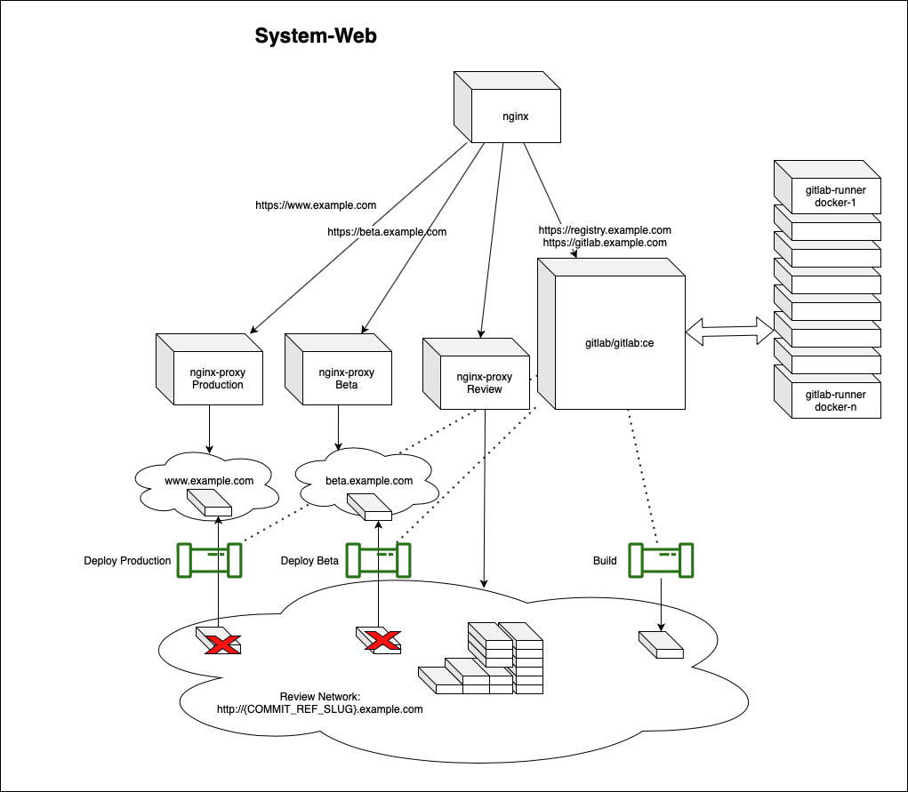

# The System — System Bootstrapper

**Bootstrap a development platform. Use it to build, test, and evolve its own next generation.**

> **You build it, you own it**

## How it started: a developer's problem, a bigger idea

Imagine you're a solo front-end developer. You want to build and maintain your own web projects. You want the freedom of self-hosting on an affordable server—but you don't want to spend your evenings configuring services, chasing broken dependencies, or planning infrastructure upgrades.

That's the problem that led me to start **System Bootstrapper** in 2019. I wanted a development platform I could bootstrap for my own projects instead of repeatedly assembling and maintaining all the pieces by hand.

But getting the platform running was only half the problem. The platform itself would age and need upgrades. That led to a bigger question: **What if the platform could use its own development tools to build, test, and deliver its next generation?**

The idea grew from a convenient self-hosted setup into an open-source framework for **generation-by-generation renewal**. The running platform provides the GitLab, runners and registry used to develop, build and test its successor. Versioned tools in this repository handle controlled controller promotion, supported GitLab upgrades and matching recovery inputs for the next host.

The original use case is still simple: spend more time building web projects and less time maintaining the infrastructure behind them. **The tool-assisted renewal workflow is available today; developers and operators choose the changes, review the evidence and authorize Production promotion.** Fully autonomous recursive improvement remains a longer-term goal.

### Born before AI. Built to evolve.

The original architecture and core principles of System Bootstrapper were developed and implemented in **2019**, before AI coding agents became part of its development workflow.

Its architectural principle is simple: **the source code is the DNA; the running infrastructure is a reconstructible instance of it.** Infrastructure definitions can be reproduced from source, while persistent state is preserved independently. Rebuilding an existing installation requires its saved configuration and secrets as well as persistent service data, such as databases and repositories.

Today, AI expands the possibilities of that original architecture. Agents can help develop and validate changes to the source code from which future system generations are built. Fully autonomous generation-to-generation renewal remains a goal rather than an already delivered capability.

**AI did not create the architecture. It expands what the architecture can achieve.**

## Getting started

Choose a complete installation path in the [System Bootstrapper Handbook](docs/HANDBOOK.md):

- [Local Ubuntu / WSL2 with HTTP](docs/HANDBOOK.md#0-getting-started): prepare your local environment, start the platform and configure it through the Wizard.
- [Public Ubuntu root server with your own domain and HTTPS](docs/HANDBOOK.md#public-server-own-domain-and-https): prepare DNS and firewall rules, issue the first certificate with Certbot, configure the services and verify certificate renewal.

Each path covers checkout, host preparation, the first Sync login, configuration
and runner setup. Moving an existing installation to another host is covered
separately in [host replacement with a retained data volume](docs/HANDBOOK.md#replace-a-host-while-retaining-its-data-volume).
[Prepare-Host.md](Prepare-Host.md#install-a-tested-public-release) covers
installation from tested, versioned public controller and Wizard images;
[the persistence guide](docs/PERSISTENT_VOLUME.md) explains local working data,
optional live volumes and separate Seed backup media. Domain names, storage
and credentials belong to your deployment.

The platform combines GitLab Community Edition, its container registry,
GitLab Runner managers, NGINX routing, an authenticated Sync API and a React
configuration Wizard. Shell scripts and Docker Compose coordinate their lifecycle.
Public release installation pulls the complete controller and matching Wizard
by immutable digest; it does not rebuild them on the new host. Docker Hub is the
public distribution path, while development, review and acceptance stay in
GitLab. Public pulls do not require a Docker Hub account, although anonymous
pull limits and network availability still apply.
A successful Wizard **Push** imports configuration and automatically restarts the
platform; **Fetch** reads the saved settings. Runner scale controls independent
managers in a shared GitLab runner pool, rather than a separate GitLab runner
registration for every container.

Application starters cover Angular, React and general web projects. The
[project guide](docs/PROJECT_BOOTSTRAP_GUIDE.md) explains private repository creation,
editable source, CI and application environments. The Wizard is itself registered
as a managed project: explicit [source initialization](docs/WIZARD_SOURCE.md),
[build configuration](docs/WIZARD_BUILD.md),
[Review/Beta environments](project-bootstrap/wizard-environments/README.md) and
[controlled Production promotion](project-bootstrap/wizard-production/README.md)
provide separate, inspectable operations. Building or merging source alone does
not replace the running management interface.

An operator with an existing Wizard development repository can instead adopt
[one source-primary Wizard project](project-bootstrap/wizard-source-primary/README.md)
for source, native checks, candidate environments and production images. This
keeps development and delivery in one repository without importing over user
changes. The legacy managed initialization remains available for other setups.

An operator can also select GitLab as the development and issue-tracking
platform with an optional [GitHub code mirror](docs/GITLAB_GITHUB_BACKUP.md).
That guide covers source-history mapping, reviewed merges, tracker migration
and verification. The mirror forwards merged code; selected live storage
and the recovery contract retain GitLab's service state.

For a bundled System/Wizard change, optional [System candidate Review jobs](docs/SYSTEM_CANDIDATE_REVIEW.md)
reuse the tested Wizard image on the configured Review HTTPS host for personal
UI acceptance before deliberate Production promotion.

Persistent service data lives beneath `PERSISTENT_DIR`, normally
`/var/lib/system-bootstrapper/platform` on the Ubuntu/WSL system disk. No second
disk or backup medium is required to start or operate the platform. An explicit
volume-backed live layout remains supported without fallback if its volume is
missing. The Wizard exports configuration separately; [Harvest/Seed](docs/RECOVERY_CONTRACT.md)
creates and restores completed service-data snapshots on independently selected
backup storage. Deleting the VM deletes its local working data: preserve a
completed external Seed and matching configuration before relying on recovery.
A retained live data filesystem can also be reused without restoring a Seed.

On 7 November 2026, a fresh public-release installation without a Seed took
**10 min 58 s**, and recovery from an external Seed into fresh local working
storage took **16 min 22 s**. These observed operator-assisted durations have
different verification scopes; they are neither a time guarantee nor a direct
performance comparison. See the [measurement context and repeatable procedure](docs/HANDBOOK.md#measured-installation-and-recovery-times)
for hardware, prerequisites and timing boundaries.

[Component and integration checks](tests/README.md) are supplied in the repository.
The candidate harness runs disposable platform instances with isolated resources.
The [evolution chapter](docs/HANDBOOK.md#5-evolving-a-running-system) documents
the complete procedure for developing, validating and deliberately promoting a
supported successor, including existing-state migration and recovery.

## Why this project exists

Setting up a development platform involves more than installing GitLab or starting a few containers. GitLab, its runners, the registry, application environments, networks, domains, and reverse proxies must work together.

System Bootstrapper encodes that setup in a repository. Docker containers provide the services, while scripts and configuration connect them into a development platform. The intended entry point is an Ubuntu host with the required access and resources; the bootstrap process should turn that host into a usable environment with minimal manual setup.

But installation is only the beginning. Dependencies change, services evolve, and a once-working environment can become difficult to update. The central purpose of this project is to make that renewal a normal, testable development workflow.

## Evolving the platform with its own tools

The running generation **A** supplies the development platform for generation
**B**. This applies to the infrastructure itself, including the controller and
supported GitLab/Runner transitions, as well as to the Wizard. Initialization,
validation, promotion and recovery tools live in the repository, so another
operator can use the same procedure with their own infrastructure and inputs.

The workflow is:

1. **Develop B using A.** Propose a change to the platform's source, image pins or
   tools through a branch and GitLab merge request.
2. **Build and test the candidate.** CI checks the committed source and builds
   the complete candidate image. Runtime changes require component checks and
   a disposable, isolated platform test; documentation-only changes use the
   short documentation lane.
3. **Validate the supported transition.** For an upgrade, test representative
   existing service data, required migrations, runner/registry behavior and
   recovery. Starting an empty candidate alone does not prove upgrade safety.
4. **Review and merge.** Keep the required gates enabled. The merged
   default-branch revision receives its own applicable checks; a merge does
   not automatically replace Production.
5. **Promote the accepted version.** Use the committed
   [controller promotion tool](bootstrapper/README.md#promoting-a-tested-successor-controller)
   and, for the declared GitLab migration, the
   [upgrade procedure](docs/HANDBOOK.md#migrate-gitlab-through-the-accepted-controller).
   They bind the operation to accepted source/image evidence and preserve
   checkpoints and recovery actions.
6. **Prepare B for the next cycle.** Verify the running services and export
   [matching recovery inputs](docs/HANDBOOK.md#export-bs-matching-recovery-inputs),
   retaining the accepted source and images. B then supplies the development
   platform and tools for the next reviewed change.

These operations are deliberately separate: promoting a controller does not
itself migrate GitLab's database. A single-node GitLab upgrade has downtime and
uses a compatible cold checkpoint for recovery; changing NGINX's target or
reverting an image cannot undo a database migration. The accepted checkout,
images, credentials and recovery inputs must remain accessible while GitLab
is unavailable, independently of the service being upgraded.

The [declared release profile](gitlab/security-release.json) and its tests define
the supported migration. A new version or component change still needs its own
acceptance criteria and successful checks; existing tools do not establish that
every possible upgrade is safe.

## Vision: automated recursive self-improvement

The next step is to extend this developer-led renewal into a feedback loop that
identifies improvements, proposes changes, evaluates them against explicit
objectives and repeats from the improved system. The machinery performing those
steps could itself evolve. Rebuilding or replacing a generation alone does not
demonstrate that it improved.

AI agents can assist with development and review through the same workflow.
Automatically selecting arbitrary improvements and promoting them recursively
is not an implemented autonomous capability. The current tools automate bounded
operations; they do not choose their own objectives or grant themselves
Production approval.

The System Cube also records a theoretical possibility for modular
communication. The `$` opening in its ASCII signature, reflected in port `8071`,
symbolizes a future opening to the outside world for introducing a seed and
communicating with other bootstrapper instances. In the intended model, each
system could expose an interface to its surroundings and contain other
communicating systems, allowing recursive composition.

The current Sync API does not implement this broader communication model.
Inter-bootstrapper communication and nested modular composition still need to
be specified and demonstrated; listening on port `8071` alone does not establish
that protocol.

## One host, multiple platform generations

A separate VM is not required for every candidate. The disposable platform harness can run alongside Production on a sufficiently provisioned host, with a separate Docker daemon, containers, networks and state. Candidate instances exist for the test and are removed afterward; a permanent second platform is not required.

Application Review/Beta environments use the entry-point NGINX service and
separate production, beta and review proxies, with dynamic application routing
through `VIRTUAL_HOST`. Those environments are separate from the full-platform
candidate harness. Passing a candidate test does not automatically route an
entire successor into Production; each supported promotion follows its declared
migration and recovery procedure.

A single host keeps the infrastructure footprint small, but it remains a shared resource and failure domain. Containers share the host kernel; they are not independent virtual machines. Host-level Ubuntu, kernel, and Docker Engine updates require their own maintenance path.

*Historical platform layout. See the [evolution chapter](docs/HANDBOOK.md#5-evolving-a-running-system) for the current supported renewal and recovery procedure.*

## What a successful renewal must prove

A candidate is not ready merely because its containers start. The [platform and migration checks](docs/HANDBOOK.md#53-validate-existing-state-migration-not-only-first-startup) must establish the behavior required by the declared change:

- GitLab is reachable and can host the platform repository.
- A runner can execute a pipeline and build an image.
- The registry can accept and serve that image.
- Domain routing reaches the correct environment.
- A candidate environment can coexist with production and be removed without affecting it.
- Upgrades work with representative existing data, not only an empty installation.
- A failed deployment has a tested recovery path.

The container definitions can be reproduced; GitLab repositories, database contents, registry data, configuration, and secrets still require deliberate persistence and protection. Updating an image is not sufficient to guarantee a safe migration, and reverting an image may not reverse a database migration.

## Repository map

| Path | Purpose in the existing implementation |
| --- | --- |
| `start.sh`, `stop.sh` | Top-level lifecycle entry points. |
| `bootstrapper/` | Base image, host initialization, recovery, runtime verification and accepted controller promotion/export tools. |
| `system/` | Main Compose definition and orchestration scripts. |
| `gitlab/` | GitLab lifecycle/configuration and supported upgrade, checkpoint and rollback tools. |
| `gitlab-runner/` | Runner configuration, registration, and lifecycle scripts. |
| `nginx/` | Entry-point reverse-proxy configuration and lifecycle scripts. |
| `nginx-proxy/` | Production, beta, and review proxy configuration. |
| `sync/` | Synchronization-related configuration and scripts. |
| `wizard/` | Configuration wizard submodule. |
| `.gitlab-ci.yml` | Short documentation lane; required runtime component, image and disposable platform checks; image publishing and optional GitHub mirror. |
| [tests/](tests/README.md) | Component inventory, isolated test commands and explicit live-integration boundaries. |
| [Prepare-Host.md](Prepare-Host.md) | Host installation, service-image selection and startup. |

## Building and verifying a deployment

Choose the local or public-server installation path in the [handbook](docs/HANDBOOK.md) and follow
[host preparation](Prepare-Host.md) for installation. Choose service versions and
configure persistent storage explicitly. The [recovery contract](docs/RECOVERY_CONTRACT.md)
describes configuration-plus-Seed restoration; the
[persistence guide](docs/PERSISTENT_VOLUME.md) covers reuse of retained live data.

Use disposable environments for restoration and candidate tests. The bootstrapper
mounts the Docker socket and can change services, networks, ports and persistent
volumes on its host. Run the documented [verification commands](tests/README.md)
and inspect their results before promoting an image. Host OS/kernel maintenance
and GitLab major-version database upgrades have their own procedures.

## Guiding principle

**Every stable generation should provide the tools to build, test, and deliver the next one.**

The goal is a maintainable development platform whose own evolution follows the same reviewable software engineering workflow it provides to its users.

## Application project bootstrap

Projects → Add Project → Save provisions a private GitLab repository and managed CI through authenticated Sync, with namespace-aware availability and asynchronous status. See the [project bootstrap guide](docs/PROJECT_BOOTSTRAP_GUIDE.md) for the workflow, retry behavior and validation. Angular, React and general web templates add editable source, Dockerfile and an initial build/test/deployment pipeline. Empty repositories remain available. Importing the existing Wizard itself stays optional.
