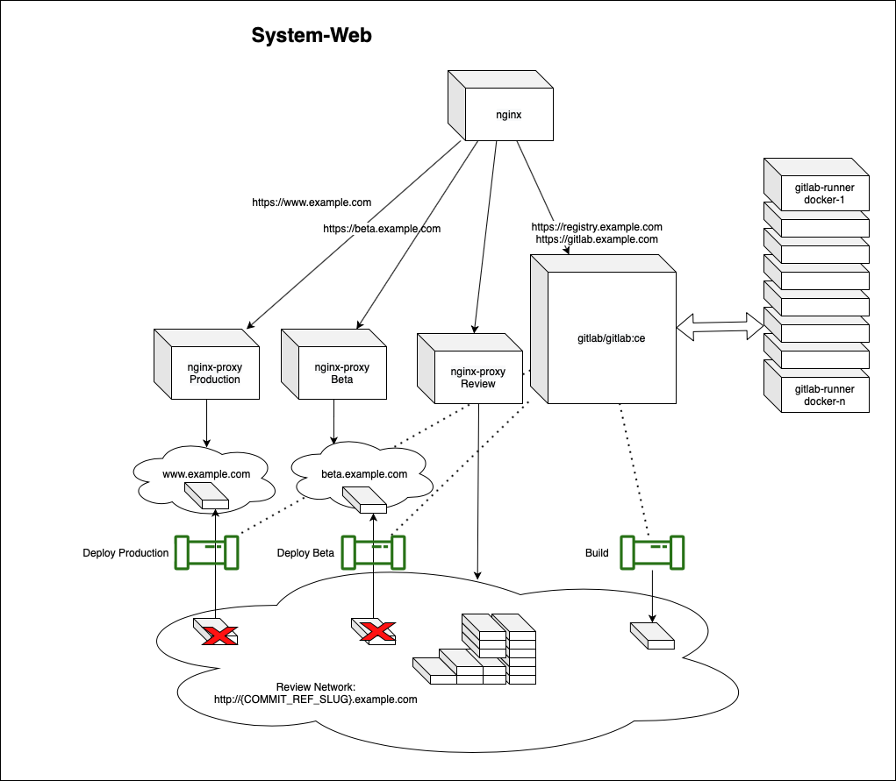

# Architecture, origins and evolution

System Bootstrapper began in 2019 with its author's need to build web projects on
an affordable self-hosted platform without repeatedly assembling its services.
The architecture and core principles predate AI coding agents. AI can assist in
its development; it did not originate the architecture.

**The source code is the DNA; the running infrastructure is a reconstructible
instance of it.** Infrastructure definitions can be reproduced from source.
Rebuilding an installation also requires saved configuration, secrets and
persistent service data, including databases and repositories.

The platform combines GitLab Community Edition, its container registry, GitLab
Runner managers, NGINX routing, an authenticated Sync API and a React configuration
Wizard. Shared TypeScript/NestJS operation services coordinate storage, routing
and host release operations; Docker Compose remains the native service runtime.

## Internal Sync API

Sync uses NestJS with the Express adapter. Feature modules separate authentication,
configuration, project workflows, operations and diagnostics; a shared runtime
module supplies operation status and the existing storage lease. Controllers handle
HTTP requests and injected services coordinate the repository-owned tools.

This structure keeps the public API on port `8071`, configuration and Seed formats,
and operational workflows compatible. It adds no database or separate deployment
service. Application starters remain Angular, React and general web projects;
NestJS is used by the internal Sync service and operations runtime. The [test guide](../tests/README.md)
provides the isolated verification commands.

## Shared operations runtime

The `operations/` package supplies typed feature modules to the authenticated
Sync API and standalone repository commands. The npm CLI exposes `install`,
`harvest` and `restore`; other operational entries remain explicit repository
commands. A Nest context starts no HTTP server and grants no deployment authority.
Services use injected process, configuration and evidence ports.

- `HostLifecycleModule` validates live storage and coordinates host start/stop
  through `HostPersistenceService` and `HostLifecycleService`.
- `HostModule` owns accepted installation, host storage dispatch, source/image
  and release authority, cold maintenance, controller/paired-upgrade coordination,
  recovery journals and runtime inspection.
- `StorageModule` owns Harvest, Seed restore and coordinated configuration backup,
  including persistent operation leases and completed recovery receipts.
- `ConfigurationModule` owns ZIP Push, impact checks and exact configuration
  replacement; `ProjectsRoutingModule` owns proxy selection, routing and rollback.
- `LifecycleModule` owns controller/runner startup and shutdown, registration,
  cancellation and the unlimited foreground prebuilt Sync process.
- `ProjectLifecycleModule`, `EnvironmentModule` and `CanonicalModule` own project
  deployment transactions, source transfer and canonical environment state.
  `PreviewOperatorModule`, `AdoptionModule`, `UpgradeModule`, `ProductionModule`
  and `SystemBetaModule` separate setup, source adoption/build upgrades, deliberate
  Wizard Production promotion and accepted-candidate System Beta.
- `GitLabUpgradeModule` owns the approved native database transition, cold
  checkpoint, readiness verification, abort and rollback under its durable guardian.
- `ReleaseModule` binds accepted source/image/job evidence to immutable image,
  GitHub and npm publication. It does not promote the running installation.

The [operation inventory](https://github.com/kihyoun/system/blob/HEAD/operations/ARCHITECTURE.md) maps public and
compatibility entries, their callers, privileges, persistent ownership, native
tools, failure handling and executable tests. Thin entries call prepared compiled
services; remaining host Python preflight/recovery responsibilities are explicitly
identified there rather than described as fully migrated adapters.

Prepare the [host runtime](../Prepare-Host.md#prepare-the-host-operations-runtime)
**before** host start/stop, persistence checks, installation or recovery. Fresh
Quickstart prepares it; source developers build it before using host lifecycle
commands. Retain Node, compiled operations and dependencies for offline recovery.
Pre-runtime bootstrapping, OS/Certbot setup, GitLab-native Ruby, independent child
guardians and byte-sensitive historical build recipes retain distinct contracts.
Docker/Compose, NGINX, Git and `flock` remain native execution boundaries. These
boundaries preserve Wizard HTTP endpoints, saved configuration and Harvest/Seed.

## Operational guide map

Application starters retain independent repositories and Review, Beta and
Production environments. The [project guide](PROJECT_BOOTSTRAP_GUIDE.md) explains
creation, editable source and CI. System and Wizard instead share the System
repository and candidate pipeline. Wizard source is an ordinary directory;
its original repository history remains reachable through the import merge.
There is no separate Wizard gitlink in new commits.

The optional [System candidate Beta](SYSTEM_CANDIDATE_REVIEW.md) reuses the exact
Wizard image from an already accepted System candidate at a fixed HTTPS address.
Setup selects an existing shared project and reserves configuration only. It
creates no extra build or complete platform pipeline. Production promotion stays
separate and deliberate. Normal project Review Apps remain supported; new System
Review bindings and deployments are retired. Existing System Review resources
require their original owned Stop and cleanup before explicit Beta migration.

Historical source receipts, JSON/ZIP configuration, bindings, generation floors,
tombstones and matching Seeds remain valid recovery inputs. Preserve their
recorded layout and identities; never reinterpret an old Wizard commit as a
shared source tree or reimport over user edits. The [source guide](WIZARD_SOURCE.md)
describes both layouts. GitLab can remain the development platform with an
optional [GitHub code mirror](GITLAB_GITHUB_BACKUP.md); mirrored source alone does
not back up GitLab service data.

The disposable Beta acceptance test performs real setup, binding, container
lifecycle, TLS and cleanup. Candidate authorization uses explicit contract
fixtures while its parent pipeline is running. It does not claim a completed
native authorization pipeline; see the [verification boundary](../tests/e2e/GUIDED_PREVIEW_ACCEPTANCE.md).

Persistent service data lives beneath `PERSISTENT_DIR`, normally
`/var/lib/system-bootstrapper/platform` on the Ubuntu/WSL system disk. No second
disk or backup medium is required to start or operate the platform. An explicit
volume-backed live layout remains supported without fallback if its volume is
missing. The Wizard exports configuration separately; [Harvest/Seed](RECOVERY_CONTRACT.md)
creates and restores completed service-data snapshots on independently selected
backup storage. Deleting the VM deletes its local working data: preserve a
completed external Seed and matching configuration before relying on recovery.
A retained live data filesystem can also be reused without restoring a Seed.

On 7 November 2026, a fresh public-release installation without a Seed took
**10 min 58 s**, and recovery from an external Seed into fresh local working
storage took **16 min 22 s**. These observed operator-assisted durations have
different verification scopes; they are neither a time guarantee nor a direct
performance comparison. See the [measurement context and repeatable procedure](HANDBOOK.md#measured-installation-and-recovery-times)
for hardware, prerequisites and timing boundaries.

[Component and integration checks](../tests/README.md) are supplied in the repository.
The candidate harness runs disposable platform instances with isolated resources.
The [evolution chapter](HANDBOOK.md#5-evolving-a-running-system) documents
the complete procedure for developing, validating and deliberately promoting a
supported successor, including existing-state migration and recovery.

## Why this project exists

Setting up a development platform involves more than installing GitLab or starting a few containers. GitLab, its runners, the registry, application environments, networks, domains, and reverse proxies must work together.

System Bootstrapper encodes that setup in a repository. Docker containers provide the services, while scripts and configuration connect them into a development platform. The intended entry point is an Ubuntu host with the required access and resources; the bootstrap process should turn that host into a usable environment with minimal manual setup.

But installation is only the beginning. Dependencies change, services evolve, and a once-working environment can become difficult to update. The central purpose of this project is to make that renewal a normal, testable development workflow.

## Evolving the platform with its own tools

The running generation **A** supplies the development platform for generation
**B**. This applies to the infrastructure itself, including the controller and
supported GitLab/Runner transitions, as well as to the Wizard. Initialization,
validation, promotion and recovery tools live in the repository, so another
operator can use the same procedure with their own infrastructure and inputs.

The workflow is:

1. **Develop B using A.** Propose a change to the platform's source, image pins or
   tools through a branch and GitLab merge request.
2. **Build and test the candidate.** CI checks the committed source and builds
   the complete candidate image. Runtime changes require component checks and
   a disposable, isolated platform test; documentation-only changes use the
   short documentation lane.
3. **Validate the supported transition.** For an upgrade, test representative
   existing service data, required migrations, runner/registry behavior and
   recovery. Starting an empty candidate alone does not prove upgrade safety.
4. **Review and merge.** Keep the required gates enabled. The merged
   default-branch revision receives its own applicable checks; a merge does
   not automatically replace Production.
5. **Promote the accepted version.** Use the committed
   [controller promotion tool](../bootstrapper/README.md#promoting-a-tested-successor-controller)
   and, for the declared GitLab migration, the
   [upgrade procedure](HANDBOOK.md#migrate-gitlab-through-the-accepted-controller).
   They bind the operation to accepted source/image evidence and preserve
   checkpoints and recovery actions.
6. **Prepare B for the next cycle.** Verify the running services and export
   [matching recovery inputs](HANDBOOK.md#export-bs-matching-recovery-inputs),
   retaining the accepted source and images. B then supplies the development
   platform and tools for the next reviewed change.

These operations are deliberately separate: promoting a controller does not
itself migrate GitLab's database. A single-node GitLab upgrade has downtime and
uses a compatible cold checkpoint for recovery; changing NGINX's target or
reverting an image cannot undo a database migration. The accepted checkout,
images, credentials and recovery inputs must remain accessible while GitLab
is unavailable, independently of the service being upgraded.

The [declared release profile](../gitlab/security-release.json) and its tests define
the supported migration. A new version or component change still needs its own
acceptance criteria and successful checks; existing tools do not establish that
every possible upgrade is safe.

## Vision: automated recursive self-improvement

The next step is to extend this developer-led renewal into a feedback loop that
identifies improvements, proposes changes, evaluates them against explicit
objectives and repeats from the improved system. The machinery performing those
steps could itself evolve. Rebuilding or replacing a generation alone does not
demonstrate that it improved.

AI agents can assist with development and review through the same workflow.
Automatically selecting arbitrary improvements and promoting them recursively
is not an implemented autonomous capability. The current tools automate bounded
operations; they do not choose their own objectives or grant themselves
Production approval.

The System Cube also records a theoretical possibility for modular
communication. The `$` opening in its ASCII signature, reflected in port `8071`,
symbolizes a future opening to the outside world for introducing a seed and
communicating with other bootstrapper instances. In the intended model, each
system could expose an interface to its surroundings and contain other
communicating systems, allowing recursive composition.

The current Sync API does not implement this broader communication model.
Inter-bootstrapper communication and nested modular composition still need to
be specified and demonstrated; listening on port `8071` alone does not establish
that protocol.

## One host, multiple platform generations

A separate VM is not required for every candidate. The disposable platform harness can run alongside Production on a sufficiently provisioned host, with a separate Docker daemon, containers, networks and state. Candidate instances exist for the test and are removed afterward; a permanent second platform is not required.

Application Review/Beta environments use the entry-point NGINX service and
separate production, beta and review proxies, with dynamic application routing
through `VIRTUAL_HOST`. Those environments are separate from the full-platform
candidate harness. Passing a candidate test does not automatically route an
entire successor into Production; each supported promotion follows its declared
migration and recovery procedure.

A single host keeps the infrastructure footprint small, but it remains a shared resource and failure domain. Containers share the host kernel; they are not independent virtual machines. Host-level Ubuntu, kernel, and Docker Engine updates require their own maintenance path.

*Historical platform layout. See the [evolution chapter](HANDBOOK.md#5-evolving-a-running-system) for the current supported renewal and recovery procedure.*

## What a successful renewal must prove

A candidate is not ready merely because its containers start. The [platform and migration checks](HANDBOOK.md#53-validate-existing-state-migration-not-only-first-startup) must establish the behavior required by the declared change:

- GitLab is reachable and can host the platform repository.
- A runner can execute a pipeline and build an image.
- The registry can accept and serve that image.
- Domain routing reaches the correct environment.
- A candidate environment can coexist with production and be removed without affecting it.
- Upgrades work with representative existing data, not only an empty installation.
- A failed deployment has a tested recovery path.

The container definitions can be reproduced; GitLab repositories, database contents, registry data, configuration, and secrets still require deliberate persistence and protection. Updating an image is not sufficient to guarantee a safe migration, and reverting an image may not reverse a database migration.

## Repository map

| Path | Purpose in the existing implementation |
| --- | --- |
| `operations/dist/cli.js start/stop --checkout PATH` | Prepared native host lifecycle entry with an explicit reviewed checkout. |
| `bootstrapper/` | Base image, host initialization, recovery, runtime verification and accepted controller promotion/export tools. |
| `system/` | Main Compose definition, controller compatibility entries and state initialization. |
| `gitlab/` | GitLab configuration/Ruby adapters, typed upgrade and publication compatibility entries. |
| `gitlab-runner/` | Runner Compose format and registration/lifecycle compatibility entries. |
| `nginx/` | Entry-point reverse-proxy configuration and typed routing adapters. |
| `nginx-proxy/` | Production, beta, and review proxy configuration. |
| `operations/` | Shared Nest feature modules, native ports and CLI; [operation inventory](https://github.com/kihyoun/system/blob/HEAD/operations/ARCHITECTURE.md). |
| `project-bootstrap/` | Project CI/source/environment compatibility entries, native GitLab adapters and versioned build recipes. |
| `sync/` | Modular NestJS API for configuration, project workflows, operations and diagnostics. |
| `wizard/` | Regular Wizard application source, with original history retained by the import merge. |
| `.gitlab-ci.yml` | Short documentation lane; required runtime component, image and disposable platform checks; image publishing and optional GitHub mirror. |
| [tests/](../tests/README.md) | Component inventory, isolated test commands and explicit live-integration boundaries. |
| [Prepare-Host.md](../Prepare-Host.md) | Host installation, service-image selection and startup. |

## Building and verifying a deployment

Choose the local or public-server installation path in the [handbook](HANDBOOK.md) and follow
[host preparation](../Prepare-Host.md) for installation. Choose service versions and
configure persistent storage explicitly. The [recovery contract](RECOVERY_CONTRACT.md)
describes configuration-plus-Seed restoration; the
[persistence guide](PERSISTENT_VOLUME.md) covers reuse of retained live data.

Use disposable environments for restoration and candidate tests. The bootstrapper
mounts the Docker socket and can change services, networks, ports and persistent
volumes on its host. Run the documented [verification commands](../tests/README.md)
and inspect their results before promoting an image. Host OS/kernel maintenance
and GitLab major-version database upgrades have their own procedures.

## Guiding principle

**Every stable generation should provide the tools to build, test, and deliver
the next one.** Its own evolution follows the reviewable software engineering
workflow it provides to its users.
