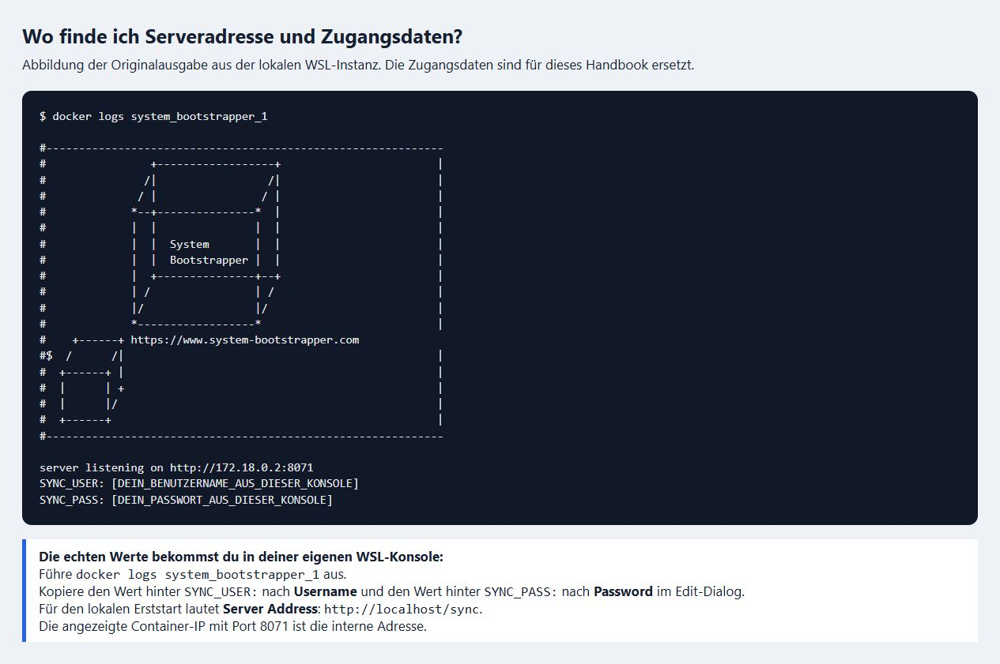
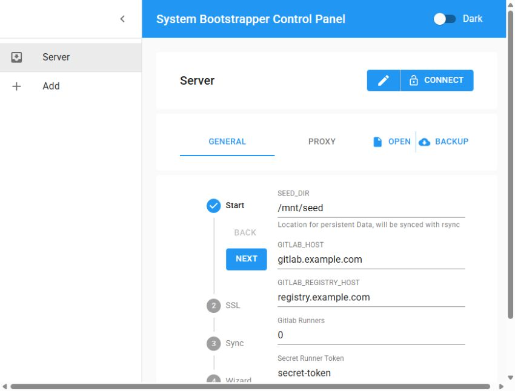
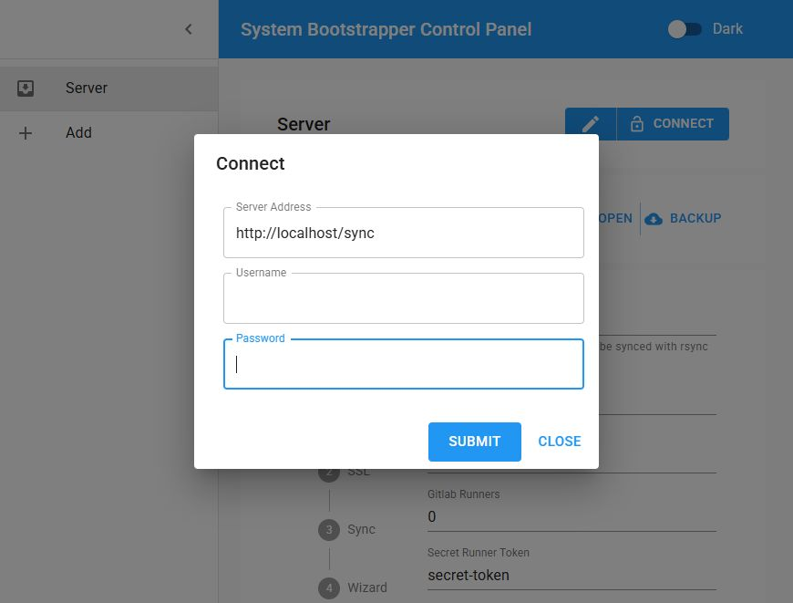
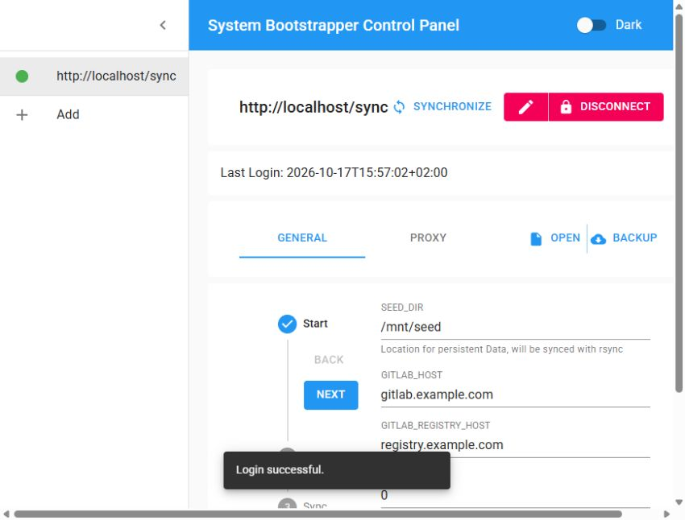
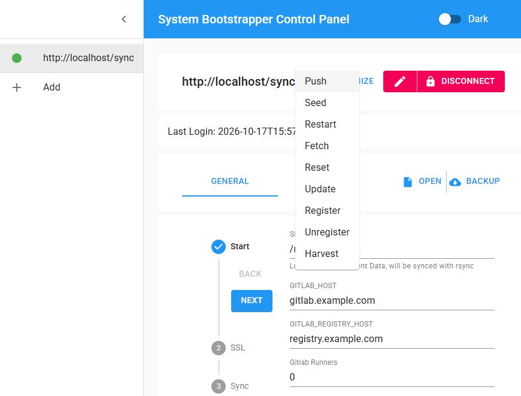
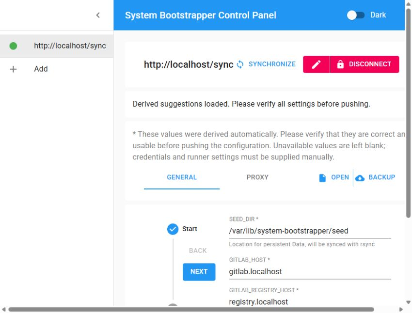
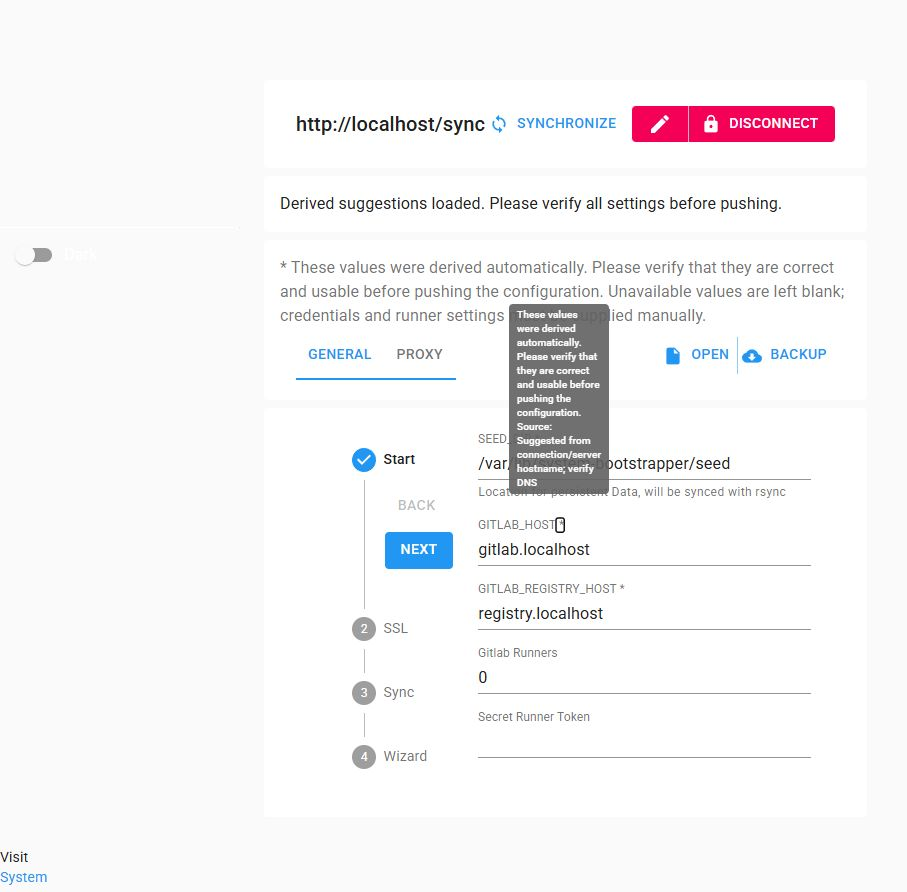

# System Bootstrapper Handbook

## 0. Getting Started

Dieses Kapitel führt dich vom Checkout bis zur ersten konfigurierten lokalen
Plattform. Du brauchst keine Kubernetes-Kenntnisse. Befehle führst du in Ubuntu
aus; die Einrichtung der Plattform erfolgt anschließend im Browser.

Der **Bootstrapper** startet und steuert die Dienste. Der **Wizard** ist seine
React-Oberfläche. Der **Sync-Dienst** verbindet die Oberfläche mit der
Bootstrapper-Instanz. GitLab, Registry und Runner kommen nach der Konfiguration
hinzu.

### 0.1 Ubuntu öffnen und Projekt auschecken

Unter Windows öffnest du eine Ubuntu-WSL2-Konsole. Falls Ubuntu noch nicht
installiert ist, führe zunächst in PowerShell aus:

```powershell
wsl --install -d Ubuntu
```

Folge den Installationsschritten und starte Windows neu, falls du dazu
aufgefordert wirst. Öffne danach Ubuntu. Alle folgenden Shell-Befehle gehören
in die **Ubuntu-Konsole**, nicht in PowerShell.

Installiere Git und lade das Projekt einschließlich Wizard-Unterprojekt:

```bash
sudo apt-get update
sudo apt-get install -y git
git clone --recurse-submodules https://github.com/kihyoun/system.git
cd system
```

Die Screenshots zeigen den lokalen Testaufbau. Die Oberfläche wird als Container-Image
gestartet: Ein aktualisierter Git-Checkout allein aktualisiert dieses Image
nicht. Für den hier dokumentierten Test wurde das neue Wizard-Image lokal
gebaut. Verwende für eigene Tests ebenfalls das zum Checkout passende Image;
der Abschnitt 0.2 unten zeigt den Build.

### 0.2 Docker vorbereiten und Wizard-Image bauen

Installiere die benötigten Docker-Werkzeuge:

```bash
sudo bash bootstrapper/install.sh
```

Der Installer installiert Docker und Compose und prüft Docker mit einem
Testcontainer. Für unseren lokalen HTTP-Test richtest du außerdem die lokalen
Hostnamen und die HTTP-Ausnahme der Registry ein:

```bash
sudo bash bootstrapper/prepare-local.sh
```

Dieser Leitfaden verwendet HTTP ausschließlich für den lokalen Test. Eine
öffentlich erreichbare Instanz benötigt eine eigene Domain- und HTTPS-Einrichtung.

Für einen reproduzierbaren Build der aktuellen Wizard-Testversion benutzt du
die im Wizard-Projekt deklarierte Node-Version und das vorhandene Lockfile:

```bash
sudo docker run --name wizard-handbook-build \
  -e CYPRESS_INSTALL_BINARY=0 \
  -v "$PWD/wizard:/source:ro" \
  node:13.12.0-alpine sh -c \
  'mkdir /app; cp -a /source/. /app/; cd /app; npm ci && npm run build'
```

Wenn dieser Build erfolgreich abgeschlossen ist, übernimm das Ergebnis in ein
lokales Wizard-Image:

```bash
build_dir=$(mktemp -d)
sudo docker cp wizard-handbook-build:/app/build "$build_dir/build"
cp wizard/nginx/nginx.conf "$build_dir/default.conf"
cat > "$build_dir/Dockerfile" <<'EOF'
FROM nginx:stable-alpine
COPY build/ /usr/share/nginx/html/
COPY default.conf /etc/nginx/conf.d/default.conf
EXPOSE 80
EOF
sudo docker build -t systembootstrapper/wizard:latest "$build_dir"
sudo docker rm wizard-handbook-build
```

Das Image bleibt lokal und wird nicht auf Docker Hub veröffentlicht. Ein
fehlgeschlagener Build muss zuerst korrigiert werden. Die alte Build-Umgebung
ist ein Übergang für diese Projektversion, keine Empfehlung für neue Anwendungen.

### 0.3 Den Bootstrapper erstmals starten

Starte aus dem Hauptverzeichnis des Projekts:

```bash
sudo env \
  GITLAB_IMAGE=gitlab/gitlab-ce:19.4.2-ce.0 \
  GITLAB_RUNNER_IMAGE=gitlab/gitlab-runner:v19.4.0 \
  GITLAB_SSH_BIND=127.0.0.1:2222 \
  GITLAB_REGISTRY_BIND=127.0.0.1:5050 \
  bash start.sh
```

Die Versionsangaben wählen die für einen **frischen lokalen Test** geprüften
GitLab- und Runner-Versionen. Diese Anleitung beschreibt kein Upgrade einer
alten GitLab-Datenbank. Ohne die explizite Auswahl verwendet das Repository
weiterhin seinen historischen GitLab-Standard.

Der Bootstrapper baut sein Image und startet zunächst Wizard und Sync-Zugang.
Er richtet an diesem Punkt noch kein vollständig konfiguriertes GitLab ein.
Der erste Build kann etwas dauern.

Mit diesen Befehlen prüfst du die Container und zeigst die Startausgabe an:

```bash
sudo docker ps
sudo docker logs system_bootstrapper_1
```

**Lass unter WSL eine Ubuntu-Konsole geöffnet**, während du die Plattform
benutzt. Ein laufender systemd-Dienst allein hält die WSL-Instanz nicht offen.

### 0.4 Signatur, Serveradresse und echte Zugangsdaten finden

In der Bootstrapper-Ausgabe erscheint der originale System Cube. Direkt darunter
stehen die Adresse des Sync-Dienstes und die Zugangsdaten:

```text
server listening on http://<interne-container-ip>:8071
SYNC_USER: <dein-tatsächlicher-benutzername>
SYNC_PASS: <dein-tatsächliches-passwort>
```



*Konsolenabbildung: Die Originalausgabe der lokalen Instanz ist für die
Dokumentation gerendert; echte Zugangsdaten sind durch Kopierhinweise ersetzt.
Die UI-Abbildungen weiter unten sind Screenshots der laufenden Oberfläche.*

**Woher kommen die echten Daten?** Aus deinem eigenen Bootstrapper-Prozess:
Führe in deiner Ubuntu-Konsole `sudo docker logs system_bootstrapper_1` aus.
Kopiere die Werte **hinter** `SYNC_USER:` und `SYNC_PASS:`, ohne diese Bezeichner
und ohne zusätzliche Leerzeichen. Die Platzhalter im Bild funktionieren nicht
als Zugangsdaten.

Die angezeigte Container-IP und Port `8071` sind die interne Node-Adresse.
Beim lokalen Erststart erreichst du den Sync-Dienst aus dem Browser über
**`http://localhost/sync`**. NGINX leitet diese Adresse an den Node-Dienst weiter.
Die interne IP kann bei jedem Container-Neustart anders aussehen.

### 0.5 Den Wizard im Browser öffnen

Öffne [http://localhost/](http://localhost/).

Wenn du dort schon eine ältere Version geöffnet hattest, lade die Seite neu.
Bei veralteter Oberfläche verwende **Strg+F5**. Ein Browsercache kann sonst noch
die vorherige Version anzeigen.



In einer noch nicht geladenen Maske können zunächst Example-Werte stehen.
Das bedeutet nicht, dass GitLab bereits unter diesen Adressen eingerichtet ist.
Klicke jetzt noch nicht auf Push oder Seed.

### 0.6 Zuerst Edit öffnen und Verbindungsdaten eintragen

Klicke auf das **Stift-Symbol direkt links neben Connect**. Es öffnet den Dialog
**Connect** mit drei Eingabefeldern.



Trage Folgendes ein:

| Feld im Edit-Dialog | Woher kommt der Wert? |
| --- | --- |
| **Server Address** | Für diesen lokalen Erststart: `http://localhost/sync` |
| **Username** | Der echte Wert hinter `SYNC_USER:` aus deiner WSL-Konsole |
| **Password** | Der echte Wert hinter `SYNC_PASS:` aus derselben Ausgabe |

**Die Zugangsdaten sind Teil der Bootstrapper-Startausgabe.** Sie sind keine
GitLab-Zugangsdaten und dürfen nicht aus dem Screenshot übernommen werden.

### 0.7 Erst jetzt verbinden

Nachdem alle drei Felder eingetragen sind, bestätige im Dialog mit **Submit**.
Dieser Button führt die Anmeldung aus; du musst danach nicht nochmals auf
Connect klicken.

Der Connect-Button im Hauptfenster ist ein Schnellzugang mit den dort bereits
hinterlegten Einstellungen. Für die erste Anmeldung benutzt du den oben
beschriebenen Edit-Dialog.



Die erfolgreiche Verbindung erkennst du an der Serveradresse, dem grünen Punkt,
dem farblich geänderten **Disconnect**-Button und dem zusätzlichen Menü
**Synchronize**. Damit ist die Verbindung zur Bootstrapper-Instanz hergestellt.

### 0.8 Die Konfiguration mit Fetch laden

Öffne **Synchronize** und wähle **Fetch**.



Es gibt zwei Fälle:

- **Die Instanz hat eine gespeicherte Konfiguration:** Fetch lädt genau diese
  Einstellungen und die vorhandenen Projekte in den Wizard.
- **Es wurde noch keine Hauptkonfiguration übertragen:** Die neue Version fragt
  abgeleitete Vorschläge vom verbundenen Bootstrapper ab und lädt sie in die Maske.



Ein **Sternchen** markiert einen abgeleiteten Wert. Bewege den Mauszeiger darüber
oder wähle das Sternchen mit der Tab-Taste an. Der Tooltip erklärt die Herkunft
und fordert dich auf, den Wert vor dem Übertragen zu prüfen.



Vorhandene NGINX-Routen haben bei den Vorschlägen Vorrang. Andernfalls können
Hostnamen aus der Verbindungsadresse vorgeschlagen werden. Vorschläge richten
kein DNS ein und beweisen nicht, dass ein Zertifikat existiert. Unbekannte Werte
bleiben leer; Passwörter und Runner-Tokens werden nicht geraten.

Fetch schreibt keine neue Konfiguration auf den Server. Es ersetzt aber Werte
in deiner Browsermaske. Sichere ungesendete Änderungen bei Bedarf vorher mit Backup.

### 0.9 Vorschläge für den lokalen Test vervollständigen

Prüfe die Abschnitte **Start**, **SSL**, **Sync** und **Wizard** unter General:

| Einstellung | Wert für unseren lokalen Test |
| --- | --- |
| `SEED_DIR` | Den von Fetch geladenen Seed-Pfad beibehalten; im Screenshot ist das `/var/lib/system-bootstrapper/seed`, bei einem unveränderten Checkout normalerweise `/mnt/seed` |
| `GITLAB_HOST` | `gitlab.localhost` |
| `GITLAB_REGISTRY_HOST` | `registry.localhost` |
| Gitlab Runners | Zunächst `0`; den Runner richten wir nach der GitLab-Anmeldung ein |
| GitLab und Registry unter SSL | **Default, HTTP** |
| Enable Synchronization Server | Einschalten |
| `SYNC_HOST` | `sync.localhost` |
| `SYNC_USER` und `SYNC_PASS` | Eigene Zugangsdaten für die spätere Verbindung festlegen und merken |
| Sync-Modus | **Default, HTTP** |
| Enable Wizard | Einschalten |
| `WIZARD_HOST` | `localhost` |
| Wizard-Modus | **Default, HTTP** |

Der Seed-Pfad ist ein Verzeichnis auf dem Docker-Host. Ändere ihn für diesen
Test nicht beiläufig: Er muss zu dem beim Start eingebundenen Verzeichnis passen.
Ein fehlender Seed ist beim Erststart normal und bedeutet eine frische Installation.

### 0.10 Konfiguration sichern, übertragen und anwenden

1. Wähle **Backup**, anschließend **Download**. Die Datei `bootstrapper.json`
   wird auf deinen Rechner geladen. Sie enthält auch Zugangsdaten; bewahre sie privat auf.
2. Wähle **Synchronize → Push** und bestätige die Übertragung. Damit sendest du
   die Einstellungen aus dem Wizard an die Instanz. Dienste können dabei gestoppt werden.
3. Lass den geöffneten Browser-Tab offen und wähle **Synchronize → Restart**.
   Die Plattform startet anschließend mit der übertragenen Konfiguration.

**Push überträgt. Restart startet die Dienste mit diesen Einstellungen.**
Mit Open kannst du eine zuvor heruntergeladene JSON wieder in den Wizard laden;
das allein verändert die Serverkonfiguration noch nicht.

### 0.11 GitLab öffnen und erstmals anmelden

Der erste GitLab-Start kann mehrere Minuten dauern. Prüfe den Zustand in Ubuntu:

```bash
sudo docker ps
```

Der GitLab-Container sollte schließlich `healthy` melden. Öffne danach
[http://gitlab.localhost/](http://gitlab.localhost/).

Der Benutzername des GitLab-Administrators lautet **`root`**. GitLab erzeugt bei
dieser Installation ein eigenes Initialpasswort. Lies es nach dem ersten Start aus:

```bash
sudo docker exec system_gitlab_1 grep 'Password:' /etc/gitlab/initial_root_password
```

Melde dich mit `root` und diesem Passwort an und verwahre den Zugang privat.
Die temporäre Passwortdatei kann beim ersten Container-Neustart nach 24 Stunden
entfernt werden. Die Sync-Zugangsdaten funktionieren nicht als GitLab-Anmeldung.

Die gesonderte Änderung für dauerhaft abrufbare GitLab-Initialpasswörter ist
nicht Voraussetzung für diesen Ablauf und muss separat geprüft werden.

### 0.12 Später wieder verbinden und Einstellungen ändern

Öffne erneut den Wizard unter [http://localhost/](http://localhost/). Nach der
oben beschriebenen Einrichtung lautet die Sync-Adresse nun
**`http://sync.localhost`**, nicht mehr der Erststart-Pfad `/sync`.

Benutze den Edit-Dialog und die von dir in Abschnitt 0.9 festgelegten
Sync-Zugangsdaten. Über **Synchronize → Fetch** lädst du die gespeicherte
Konfiguration. Du kannst sie ändern, mit Backup lokal sichern und anschließend
über Push und Restart anwenden.

Die ersten Schritte bis einschließlich Fetch wurden mit der abgebildeten
frischen lokalen Instanz durchgeführt. Die Einrichtung von GitLab und Runner
wurde zuvor separat lokal geprüft; dieses Handbook ist keine Zusage für einen
Produktionsbetrieb oder eine Datenmigration.

## 1. Die wichtigsten Aktionen

| Aktion | Was passiert? |
| --- | --- |
| Edit (Stift) | Öffnet den Dialog für Serveradresse und Sync-Zugangsdaten |
| Submit / Connect | Meldet den Wizard am Sync-Dienst an |
| Disconnect | Beendet die Verbindung des Wizards |
| Open | Lädt eine Konfigurationsdatei vom eigenen Rechner in den Wizard |
| Backup | Lädt die Wizard-Konfiguration als JSON auf den eigenen Rechner herunter |
| Fetch | Holt gespeicherte Instanzeinstellungen; ohne Konfiguration lädt die neue Version markierte Vorschläge |
| Push | Überträgt die Wizard-Konfiguration an die Instanz |
| Restart | Startet die Dienste mit der übertragenen Konfiguration neu |
| Register / Unregister | Registriert konfigurierte Runner beziehungsweise meldet sie ab |
| Harvest | Kopiert persistente Dienstedaten und Zertifikate in das Seed-Verzeichnis |
| Seed | Stellt Daten aus dem Seed wieder her; vorhandene Zieldaten können überschrieben werden |
| Reset | Löscht die Hauptkonfiguration und Projektkonfigurationen über den Reset-Ablauf |
| Update | Aktualisiert den Quellcode über den vorhandenen Update-Ablauf |

**Konfiguration und persistente Dienstedaten sind getrennt.** Open/Backup und
Push/Fetch verwalten die Konfiguration. Harvest/Seed betreffen die Dienstedaten.
Du brauchst Harvest oder Seed nicht, um eine Konfiguration mit Fetch anzusehen.

Hinweis zum aktuellen Code: Die bestehende Wizard-Aktion **Seed** überträgt vor
der Wiederherstellung auch die Hauptkonfiguration aus der Maske. Prüfe diese
daher vor dem Aufruf. Diese Kopplung wurde mit den Erststart-Vorschlägen nicht
geändert. Für die Ersteinrichtung in Kapitel 0 verwendest du Push und Restart.

Harvest allein ist noch kein nachgewiesen konsistentes GitLab-Datenbankbackup.
Wiederherstellung, Updates und Produktivbetrieb brauchen zusätzliche Validierung.

## 2. Wenn etwas nicht funktioniert

| Beobachtung | Nächster Schritt |
| --- | --- |
| `localhost` öffnet sich nicht | Ubuntu-Konsole offen lassen und `sudo docker ps` prüfen |
| Connect meldet Network Error | Über Edit die Adresse prüfen: beim lokalen Erststart `http://localhost/sync`, danach die konfigurierte Sync-Domain |
| Anmeldung wird abgelehnt | Aktuelle Werte aus `sudo docker logs system_bootstrapper_1` verwenden; nach einer Konfiguration die selbst festgelegten Werte benutzen |
| Example-Werte stehen in der Maske | Zuerst verbinden und Fetch ausführen; eine unverbundene Maske ist noch keine Serverkonfiguration |
| Fetch liefert bei einer frischen Instanz 404 | Wizard neu laden; für Vorschläge müssen Wizard und Sync-Dienst beide die passende PR-Version verwenden |
| Gespeicherte Example-Werte kommen wieder | Fetch hat Vorrang für gespeicherte Einstellungen. Korrigiere sie bewusst im Wizard; Vorschläge überschreiben keine vorhandene Konfiguration |
| GitLab ist noch nicht erreichbar | Bei Erststart nach Push und Restart auf `healthy` warten und bei Problemen die GitLab-Logs prüfen |
| In `docker ps` fehlt ein eigener Sync-Node-Container | Normal: Node läuft im Bootstrapper-Container. `system_sync_1` ist beim Erststart der NGINX-Zugang |

Weitere technische Details stehen in [Prepare-Host.md](../Prepare-Host.md).
