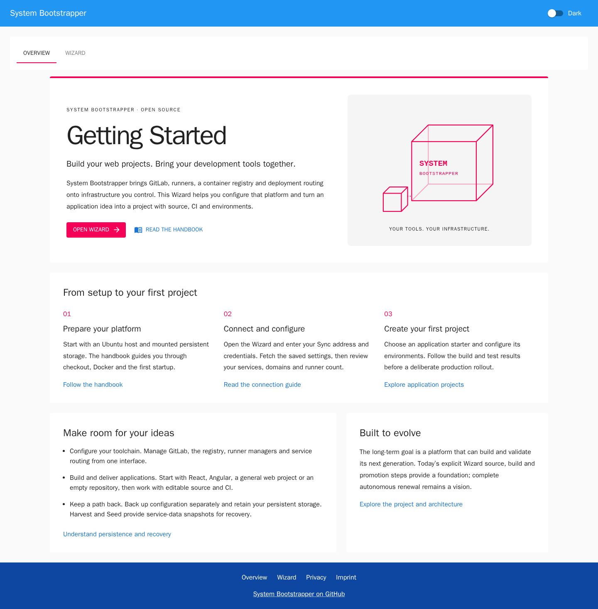
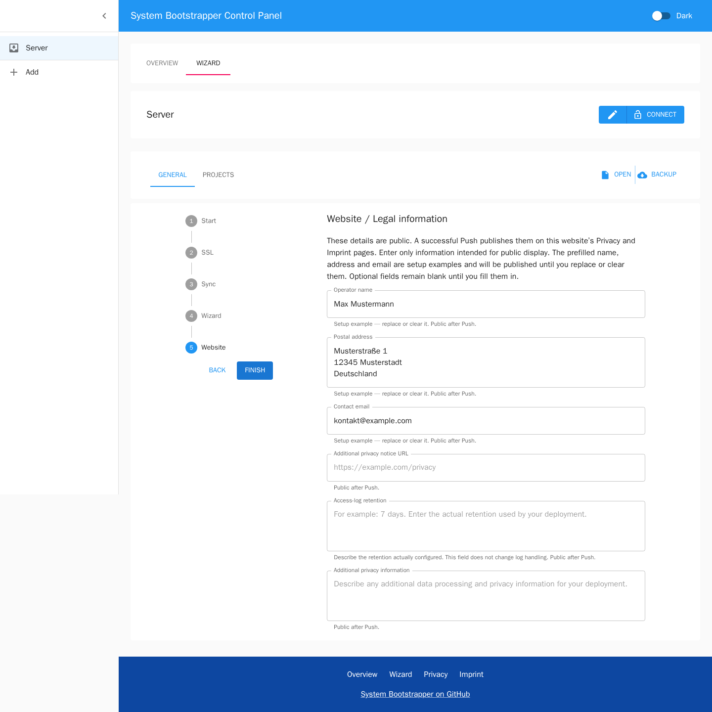

# System Bootstrapper Handbook

Choose the complete installation path for your environment:

- [Local Ubuntu / WSL2 with HTTP](#0-getting-started): try the platform on your
  own computer, without public DNS or a certificate.
- [Public Ubuntu server with your domain and HTTPS](#public-server-own-domain-and-https):
  prepare DNS, issue certificates with Certbot and configure the services.
- [Replacement host with a retained data volume](#replace-a-host-while-retaining-its-data-volume):
  reuse an existing installation, rather than initializing it again.
- [Evolve a running system](#5-evolving-a-running-system): use one generation
  to build and test a reviewed successor, then promote it with a recovery path.

## 0. Getting Started

This is the **local Ubuntu / WSL2 HTTP** installation. Keep it on a trusted local
computer; do not expose this unencrypted setup as a public service. You do not
need Kubernetes experience. Run commands in Ubuntu, then configure the platform
in your browser. Native Ubuntu users can skip the Windows installation step.

The **Bootstrapper** starts and manages the services. The **Wizard** is its
React interface. The **Sync service** connects the interface to the Bootstrapper
instance. GitLab, the registry and runners are added after configuration.

### 0.1 Open Ubuntu and check out the project

On Windows, open an Ubuntu WSL2 console. If Ubuntu is not installed yet, first
run this command in PowerShell:

```powershell
wsl --install -d Ubuntu
```

Follow the installation steps and restart Windows if prompted. Then open Ubuntu.
Run all subsequent shell commands in the **Ubuntu console**, rather than PowerShell.

Install Git and download the project, including the Wizard submodule:

```bash
sudo apt-get update
sudo apt-get install -y git
git clone --recurse-submodules https://github.com/kihyoun/system.git
cd system
```

The screenshots illustrate a local setup. The interface runs as a container
image: updating the Git checkout alone does not update that image. Build an image
from the pinned Wizard checkout as described in section 0.2.

### 0.2 Prepare Docker and build the Wizard image

Install the required Docker tools:

```bash
sudo bash bootstrapper/install.sh
```

The installer installs Docker and Compose and checks Docker using a test
container. For the local HTTP test, also configure the local hostnames and the
registry's HTTP exception:

```bash
sudo bash bootstrapper/prepare-local.sh
```

WSL may regenerate `/etc/hosts` at startup. If the registry or other local
hostnames later stop resolving, run this preparation step again. It reloads the
Docker configuration without restarting the containers. The HTTP exception
remains limited to the local test.

This guide uses HTTP exclusively for local testing. A publicly accessible
instance requires its own domain and HTTPS configuration.

The pinned Wizard uses React 19, Vite 8 and Node 24. Its Dockerfile selects the
exact Node image, installs the committed lockfile, runs its checks and builds the
interface. Build the local image from the checked-out submodule:

```bash
sudo docker build -t systembootstrapper/wizard:latest wizard
```

The image stays local and is not published to Docker Hub. Resolve any build
failure before continuing. For development outside Docker, use the Node and npm
versions declared in `wizard/.nvmrc` and `wizard/package.json`.

### 0.3 Start the Bootstrapper for the first time

Startup requires a separately mounted filesystem for persistent service data.
Prepare and mount your storage using the [persistent-volume guide](PERSISTENT_VOLUME.md)
before continuing; an ordinary directory on the root filesystem does not satisfy
the startup guard. Retain an existing filesystem's contents when reusing it.

Create the host selector file for your own mount. For example, if your filesystem
is already mounted at `/mnt/bootstrapper`, use:

```bash
sudo install -d -m 0755 /etc/system-bootstrapper
sudo tee /etc/system-bootstrapper/persistence.env >/dev/null <<'EOF'
PERSISTENT_MOUNT=/mnt/bootstrapper
PERSISTENT_DIR=/mnt/bootstrapper/platform
SEED_DIR=/mnt/bootstrapper/seed
EOF
sudo chmod 600 /etc/system-bootstrapper/persistence.env
```

Replace the example mount path in all three assignments if yours differs. Keep
`SEED_DIR` and `PERSISTENT_DIR` separate beneath the mounted filesystem. You can
also set `PERSISTENT_UUID` to require a specific filesystem identity.

Then run this command from the project's root directory:

```bash
sudo env \
  GITLAB_IMAGE=gitlab/gitlab-ce:19.4.3-ce.0@sha256:483fb4cc5c75237a7a6c7c8b8b2a1832ed790d86e0449ff55e8b6f6d62d2d5f5 \
  GITLAB_RUNNER_IMAGE=gitlab/gitlab-runner:v19.4.0 \
  GITLAB_SSH_BIND=127.0.0.1:2222 \
  GITLAB_REGISTRY_BIND=127.0.0.1:5050 \
  bash start.sh
```

These selectors pin the GitLab and runner images for a **fresh installation**.
They are not an upgrade procedure for an existing GitLab database. Without these
explicit settings, the repository uses its historical GitLab default. When
reusing an installation, preserve its recorded image selectors and follow the
GitLab upgrade requirements rather than replacing them with this example.

The Bootstrapper builds its image and initially starts the Wizard and Sync
access point. GitLab is not fully configured at this stage. The first build
may take some time.

Check the containers and view the startup output with:

```bash
sudo docker ps
sudo docker logs system_bootstrapper_1
```

**Keep an Ubuntu console open under WSL** while using the platform. A running
systemd service alone does not keep the WSL instance alive.

### 0.4 Find the signature, server address and actual credentials

The original System Cube and listening address appear in the Bootstrapper output:

```text
server listening on http://<internal-container-ip>:8071
Sync authentication is configured.
```

Credentials are not printed in the logs. At first startup, generated credentials
are saved privately in `PERSISTENT_DIR/configuration/sync-auth.env`. Once a main
configuration exists, its `SYNC_USER` and `SYNC_PASS` override those initial values.

Run this command locally on your own Docker host to display only the active Sync
username and password. It uses the same precedence as startup:

```bash
sudo bash -c '
  set -euo pipefail
  source /etc/system-bootstrapper/persistence.env
  source "$PERSISTENT_DIR/configuration/sync-auth.env"
  if [[ -f "$PERSISTENT_DIR/configuration/.docker.env" ]]; then
    source "$PERSISTENT_DIR/configuration/.docker.env"
  fi
  printf "Username: %s\nPassword: %s\n" "$SYNC_USER" "$SYNC_PASS"
'
```

Use the printed values in the connection dialog. Keep this terminal output
private. If you selected a custom `PERSISTENCE_ENV_FILE` at startup, use that
selector file in the command instead. Screenshots and placeholders do not
supply valid credentials for your installation.

The displayed container IP and port `8071` are the internal Node address. During
local first startup, access Sync from the browser at **`http://localhost/sync`**.
NGINX forwards this address to the Node service. The internal IP may change
whenever the container restarts.

### 0.5 Open the Wizard in your browser

Open [http://localhost/](http://localhost/).

The **Overview** opens with the project introduction, **Getting Started**
instructions and links to the handbook. Choose **Open Wizard** or the top **Wizard** tab to reach the
configuration workspace shown below. Switching between Overview, Wizard and
the footer's legal pages preserves your connection and unsent form values;
reloading the browser resets that local state.



If an older version is already open, reload the page. Use **Ctrl+F5** if the
interface looks outdated; the browser cache may still contain the previous version.


Before loading a configuration, the form may contain Example values. This does
not mean GitLab has already been configured at those addresses. Do not click
Push or Seed yet.

### 0.6 Open Edit and enter the connection details first

Click the **pencil icon immediately to the left of Connect**. It opens the
**Connect** dialog with three input fields.


Enter the following:

| Field in the Edit dialog | Source of the value |
| --- | --- |
| **Server Address** | For this local first startup: `http://localhost/sync` |
| **Username** | The active Sync username displayed by the private local command in section 0.4 |
| **Password** | The active Sync password displayed by the same command |

**These credentials come from your own persistent configuration.** They are
separate from GitLab credentials. Do not copy them from the screenshot.

### 0.7 Connect after entering all three fields

Confirm the dialog with **Submit** after filling in all three fields. This
button signs you in; you do not need to click Connect again afterwards.

The Connect button in the main window is a shortcut using the connection settings
already stored there. Use the Edit dialog described above for your first login.


The server address, green dot, changed **Disconnect** button color and additional
**Synchronize** menu indicate a successful connection to the Bootstrapper instance.

### 0.8 Load the configuration with Fetch

Open **Synchronize** and select **Fetch**.


There are two cases:

- **The instance has a saved configuration:** Fetch loads those exact settings
  and the existing projects into the Wizard.
- **No main configuration has been transferred yet:** the current version requests
  derived suggestions from the connected Bootstrapper and loads them into the form.


An **asterisk** marks a derived value. Hover over it or focus it with the Tab key.
Its tooltip explains the source and asks you to verify the value before transfer.


Existing NGINX routes take priority when deriving suggestions. Otherwise,
hostnames may be suggested from the connection address. Suggestions do not set
up DNS or prove that a certificate exists. Unknown values remain empty;
passwords and runner tokens are not guessed.

Fetch does not write a new configuration to the server, but it replaces values
in your browser form. Use Backup first if you need to preserve unsent changes.

### 0.9 Complete the suggestions for the local test

Check the **Start**, **SSL**, **Sync** and **Wizard** sections under General:

| Setting | Value for this local test |
| --- | --- |
| `SEED_DIR` | Keep the path selected on the host, for example `/mnt/bootstrapper/seed` |
| `GITLAB_HOST` | `gitlab.localhost` |
| `GITLAB_REGISTRY_HOST` | `registry.localhost` |
| Gitlab Runners | Initially `0`; configure the runner after signing into GitLab |
| GitLab and registry under SSL | **Default, HTTP** |
| Enable Synchronization Server | Enable |
| `SYNC_HOST` | `sync.localhost` |
| `SYNC_USER` and `SYNC_PASS` | Choose and remember your own credentials for subsequent connections |
| Sync mode | **Default, HTTP** |
| Enable Wizard | Enable |
| `WIZARD_HOST` | `localhost` |
| Wizard mode | **Default, HTTP** |

The seed path is a directory on the Docker host. Keep it consistent with the
directory mounted at startup. A missing seed is normal on first startup and
means this is a fresh installation.

#### Public website and operator information

In **General → Website**, review the information displayed by the footer's
**Imprint** and **Privacy** pages. Operator name, postal address and contact email
start with the visible setup examples **Max Mustermann**, **Musterstraße 1,
12345 Musterstadt, Deutschland** and **kontakt@example.com**. These are actual
form values as well as input placeholders: replace them with your own public
details, or clear them. The public pages identify unchanged examples as such.
An explicitly cleared field stays empty; absent fields in older configurations
receive the setup examples.



Optional fields provide a link to an additional privacy notice, the access-log
retention actually used by your deployment and additional privacy text. The
retention description does not change logging or rotation. All six fields are
public; do not enter passwords, tokens or other confidential information there.

**Backup**, **Open**, **Fetch** and **Push** include these settings. A successful
Push applies them through the normal platform restart, without an image rebuild
or CI pipeline. Startup writes only these six public strings to
`privacy-instance.json` on dedicated persistent storage. The Wizard reads that
publication without retrieving the authenticated Sync configuration.

### 0.10 Back up, transfer and apply the configuration

1. Select **Backup → bootstrapper.json → Download** to save the editable
   configuration, or **Backup → bootstrapper.zip** for JSON plus generated
   environment files. Both contain credentials; keep them private.
2. Select **Synchronize → Push** and confirm the transfer. This sends the Wizard
   settings to the instance and automatically restarts services after a successful
   import. The interface is temporarily unavailable while services start.
3. Wait for the interface to return, then reconnect and Fetch to verify the settings.

**Push transfers and applies settings. No separate Restart click is required.**
Open loads a previously downloaded JSON file into the Wizard; loading the file
alone does not change the server configuration.

### 0.11 Open GitLab and sign in for the first time

GitLab's first startup may take several minutes. Check its status in Ubuntu:

```bash
sudo docker ps
```

The GitLab container should eventually report `healthy`. Then open
[http://gitlab.localhost/](http://gitlab.localhost/).

The GitLab administrator username is **`root`**. For a fresh database, the
Bootstrapper generates a random initial password. An installation prepared with
a complete private configuration may instead set `GITLAB_INITIAL_ROOT_PASSWORD`
to at least 12 characters in `PERSISTENT_DIR/configuration/.docker.env` before
GitLab's first startup. The Wizard has no dedicated field for this optional value.

Read the initial password locally after the first startup:

```bash
sudo docker exec system_gitlab_1 cat /etc/gitlab/bootstrapper_initial_root_password
```

This root-readable file is stored in GitLab's persistent configuration volume
and survives restarts. Sign in as `root` and keep the credentials private. The
file records the initial password; later password changes are not written back
to it. Harvest also includes it in the seed through the GitLab configuration
volume, so keep the seed private too.

An existing database is left unchanged. If it was set up without this mechanism,
no file containing an assumed login password is created retroactively. You can
check GitLab's native temporary file if it is still present:

```bash
sudo docker exec system_gitlab_1 grep 'Password:' /etc/gitlab/initial_root_password
```

GitLab may remove this native file on a container restart after 24 hours. If no
valid password is known, a targeted GitLab password reset is required. Sync
credentials are independent of the GitLab login.

### 0.12 Reconnect later and change settings

Open the Wizard again at [http://localhost/](http://localhost/). After completing
the setup above, the Sync address is **`http://sync.localhost`**, replacing the
first-startup `/sync` path.

Use the Edit dialog and the Sync credentials you chose in section 0.9. Load the
saved configuration with **Synchronize → Fetch**. You can change it, save a local
Backup, then apply it with Push (which restarts automatically).

For public use, configure your own DNS, HTTPS certificates and host certificate
renewal. Reusing a database or moving persistent storage requires the separate
[recovery procedure](RECOVERY_CONTRACT.md).

## Public server: own domain and HTTPS

This path installs a **fresh** platform on an Ubuntu 24.04 LTS server with sudo
access, a separately mounted ext4 data volume and a domain you control. Reusing
GitLab data requires the [replacement-host procedure](#replace-a-host-while-retaining-its-data-volume)
instead. Allocate memory, CPU and disk for GitLab plus the runner jobs you intend
to run; the Docker installation check does not establish that capacity.

The example uses `www.example.com` for the Wizard, `sync.example.com` for Sync,
`gitlab.example.com` for GitLab and `registry.example.com` for the registry.
Replace these names, the server address, administrator account and contact email
throughout. No service is configured on the bare `example.com` name in this
example; obtaining a certificate alone does not create routing for an alias.

### Public 1. Prepare DNS, ports and the host

Create these DNS records at your DNS provider. `203.0.113.10` is a documentation
address: use your server's real public IPv4 address.

| DNS name | Type | Value |
| --- | --- | --- |
| `www.example.com` | A | `203.0.113.10` |
| `sync.example.com` | A | `203.0.113.10` |
| `gitlab.example.com` | A | `203.0.113.10` |
| `registry.example.com` | A | `203.0.113.10` |

Publish AAAA records only if this server actually serves these names over IPv6.
Remove stale IPv6 records before requesting certificates. Check all four names
from a computer outside the server, for example with `dig +short A NAME` and
`dig +short AAAA NAME`. They must resolve to this host; allow DNS changes to
propagate before proceeding.

Configure the **provider's external firewall** for this fresh server:

| Inbound traffic | Initial certificate issuance | Initial Wizard setup | Finished HTTPS installation |
| --- | --- | --- | --- |
| Your SSH port, normally TCP 22 | Allow from your administration address | Keep allowed | Keep allowed |
| TCP 80 | Allow publicly for HTTP-01 | Block public access | Allow publicly for redirects and HTTP-01 renewal |
| TCP 443 | Keep closed | Keep closed until HTTPS is configured | Allow publicly |
| TCP 8071, 5050 and 2222 | No public rule required | No public rule required | No public rule required for this example |

Apply the same restrictions in any host firewall. Keep your working SSH session
open while changing rules. The later SSH tunnel secures your browser connection;
it does **not** restrict the Bootstrapper's port-80 listener. The external rule
is therefore required during its temporary HTTP setup.

Connect with SSH and run these commands on the server:

```bash
sudo apt-get update
sudo apt-get install -y git certbot dnsutils openssl
certbot --version
git clone --recurse-submodules https://github.com/kihyoun/system.git
cd system
sudo bash bootstrapper/install.sh
sudo docker build -t systembootstrapper/wizard:latest wizard
```

Use Certbot **2.3.0 or newer**, which supports `reconfigure`; the Ubuntu 24.04
[package provides that interface](https://packages.ubuntu.com/noble/certbot).
The host integration below invokes
`/usr/bin/certbot` and `certbot.timer`, so this recipe uses the distribution
package, rather than a separate Snap installation. Do not run
`bootstrapper/prepare-local.sh`: public DNS and a trusted HTTPS registry replace
its local hosts-file and insecure-registry changes.

### Public 2. Mount storage and install certificate integration

Identify and mount your data filesystem with `lsblk -f`, `mount` and `findmnt`.
Follow [persistent-volume preparation](PERSISTENT_VOLUME.md#paths-and-selectors)
and use the actual ext4 mount point and UUID. Do not format an existing volume.
For an already mounted filesystem at `/mnt/bootstrapper-data`, create:

```bash
sudo install -d -m 0700 /etc/system-bootstrapper
sudo tee /etc/system-bootstrapper/persistence.env >/dev/null <<'EOF'
PERSISTENT_MOUNT=/mnt/bootstrapper-data
PERSISTENT_DIR=/mnt/bootstrapper-data/platform
SEED_DIR=/mnt/bootstrapper-data/seed
EOF
sudo chmod 0600 /etc/system-bootstrapper/persistence.env
sudo bash bootstrapper/install-volume-host.sh
sudo systemctl stop certbot.timer
```

Optionally add `PERSISTENT_UUID` with the actual filesystem UUID to require that
identity. The integration validates the mount, persists its fstab dependency,
connects `/etc/letsencrypt` to `PERSISTENT_DIR/host/letsencrypt`, installs the
`system-certbot` lock wrapper and certificate deploy hook. A conflicting active
Certbot tree is an error to reconcile, not a reason to delete certificate state.
The timer is temporarily stopped while we change the renewal method below.

### Public 3. Obtain the first certificate before starting the platform

At this point **nothing may occupy host port 80**. Inspect `sudo ss -ltnp` and
resolve any existing host web server or container deliberately. Keep public TCP
80 open for this step. Certbot's standalone server can then answer HTTP-01
without needing NGINX or a certificate first:

```bash
sudo system-certbot certonly --standalone --non-interactive --agree-tos \
  --email YOUR_CONTACT_EMAIL --cert-name example.com \
  -d www.example.com -d sync.example.com \
  -d gitlab.example.com -d registry.example.com
sudo system-certbot certificates --cert-name example.com
sudo env RENEWED_LINEAGE=/etc/letsencrypt/live/example.com \
  /usr/local/sbin/system-install-certificate
```

Use a real contact email. The certificate must list all four service names and
must come from the production CA, rather than a staging certificate. If issuance
fails, check DNS/AAAA records, TCP 80 reachability and an occupied port before
retrying; do not repeatedly request new certificates to diagnose routing.

`--cert-name example.com` fixes the lineage directory name; it does not add the
bare domain to the certificate. The installed deploy hook copies the certificate
and private key to `PERSISTENT_DIR/ssl/live/example.com/`. The explicit command
also makes that first copy available before a proxy exists.

| Purpose | Path |
| --- | --- |
| Complete retained Certbot state | `PERSISTENT_DIR/host/letsencrypt/`, exposed on the host as `/etc/letsencrypt` |
| Host source certificate and key | `/etc/letsencrypt/live/example.com/fullchain.pem` and `privkey.pem` |
| Deployed copies on the data volume | `PERSISTENT_DIR/ssl/live/example.com/fullchain.pem` and `privkey.pem` |
| Paths to enter in the Wizard, inside NGINX | `/ssl/live/example.com/fullchain.pem` and `/ssl/live/example.com/privkey.pem` |

Keep the whole Certbot tree, including `archive`, account and renewal state.
Copying just its `live` symlinks is insufficient. The Wizard does not issue a
certificate, and NGINX does not read a host `/etc/letsencrypt` path directly.

### Public 4. Configure the first startup through an SSH tunnel

**Block public TCP 80 again at the provider firewall before starting the
Bootstrapper.** Keep TCP 443 closed for now. From the project directory on the
server, start the fresh installation:

```bash
sudo env \
  GITLAB_IMAGE=gitlab/gitlab-ce:19.4.3-ce.0@sha256:483fb4cc5c75237a7a6c7c8b8b2a1832ed790d86e0449ff55e8b6f6d62d2d5f5 \
  GITLAB_RUNNER_IMAGE=gitlab/gitlab-runner:v19.4.0 \
  GITLAB_SSH_BIND=127.0.0.1:2222 \
  GITLAB_REGISTRY_BIND=127.0.0.1:5050 \
  bash start.sh
sudo docker ps
sudo docker logs system_bootstrapper_1
```

These image versions are a fresh-install example, **not an upgrade procedure**
for an existing GitLab database. GitLab SSH stays on loopback port 2222, so it
cannot take the host's administration port. Registry clients will use its HTTPS
name on port 443; direct host port 5050 stays private.

On **your own computer**, open another terminal and keep this tunnel running:

```bash
ssh -N -o ExitOnForwardFailure=yes \
  -L 127.0.0.1:8080:127.0.0.1:80 ADMIN_USER@SERVER_IP
```

Use your SSH account, server address and `-p PORT` if needed. Open
`http://localhost:8080/`, choose **Wizard**, then use the pencil/Edit dialog with
Server Address **`http://localhost:8080/sync`**. Read the generated Sync credentials
on the server using the private command in [section 0.4](#04-find-the-signature-server-address-and-actual-credentials).
Submit the connection and select **Synchronize → Fetch**. For a fresh instance,
Fetch returns suggestions: verify and replace them with this table.

| Section / Wizard field | Value for this public example |
| --- | --- |
| General → Start: `SEED_DIR` | `/mnt/bootstrapper-data/seed`, matching the host selector |
| General → Start: `GITLAB_HOST` | `gitlab.example.com` |
| General → Start: `GITLAB_REGISTRY_HOST` | `registry.example.com` |
| General → Start: Gitlab Runners / Runner authentication token | Initially `0` / empty; register after GitLab is healthy |
| General → SSL: `GITLAB_DOMAIN_MODE`, `GITLAB_REGISTRY_DOMAIN_MODE` | **SSL encrypted**, value `2`, for both |
| General → SSL: `GITLAB_SSL`, `GITLAB_REGISTRY_SSL` | `/ssl/live/example.com/fullchain.pem` for both |
| General → SSL: `GITLAB_SSL_KEY`, `GITLAB_REGISTRY_SSL_KEY` | `/ssl/live/example.com/privkey.pem` for both |
| General → Sync: Enable Synchronization Server / `SYNC_HOST` | Enable / `sync.example.com` |
| General → Sync: `SYNC_USER`, `SYNC_PASS` | Your own non-default username and strong password |
| General → Sync: `SYNC_DOMAIN_MODE` | **SSL encrypted**, value `2` |
| General → Sync: `SYNC_SSL`, `SYNC_SSL_KEY` | `/ssl/live/example.com/fullchain.pem`, `/ssl/live/example.com/privkey.pem` |
| General → Wizard: Enable Wizard / `WIZARD_HOST` | Enable / `www.example.com` |
| General → Wizard: `WIZARD_DOMAIN_MODE` | **SSL encrypted**, value `2` |
| General → Wizard: `WIZARD_SSL`, `WIZARD_SSL_KEY` | `/ssl/live/example.com/fullchain.pem`, `/ssl/live/example.com/privkey.pem` |

The fields require the **full container paths**, including `/ssl`; any path
adornment displayed beside an input is not a replacement for that prefix. Use
hostnames without a scheme in the `*_HOST` fields. The generated GitLab and
registry external URLs must be `https://gitlab.example.com` and
`https://registry.example.com`, without `:5050`. The historical
`system/.docker.env.example` contains `/live/...` paths without the `/ssl` mount
prefix; those paths are inactive in HTTP mode and must not be copied unchanged
when enabling HTTPS. Review **General → Website** and
replace the public operator examples before publishing your site.

Save **Backup → bootstrapper.json** or **bootstrapper.zip** privately, then use
**Synchronize → Push**. A successful Push applies the configuration and restarts
the platform; the temporary `/sync` tunnel endpoint stops working as configured
HTTPS routing takes over. Do not invoke Seed to perform this fresh setup.

### Public 5. Check HTTPS, then allow public traffic

Keep SSH access and the external restriction while services start. On the server:

```bash
sudo docker ps
sudo docker exec system_web_1 nginx -t
curl --resolve www.example.com:443:127.0.0.1 -I https://www.example.com/
curl --resolve gitlab.example.com:443:127.0.0.1 -I https://gitlab.example.com/users/sign_in
curl --resolve registry.example.com:443:127.0.0.1 -I https://registry.example.com/v2/
```

Wait for GitLab to report `healthy`. The Wizard must return HTTP 200, GitLab's
sign-in page must be reachable, and an unauthenticated registry request normally
returns HTTP 401 with an authentication challenge. Do not use `curl -k`: a
hostname mismatch or untrusted certificate needs correction.

Now allow **public TCP 80 and 443** at the provider and host firewalls. From your
computer, open `https://www.example.com/`. Connect the Wizard to
**`https://sync.example.com`** with the Sync credentials you saved, then Fetch and
check the saved hostnames, modes and projects. HTTP requests for the four service
names should redirect to HTTPS, while HTTP-01 challenge files remain available
on port 80. Close the temporary SSH tunnel when it is no longer needed.

Read the initial GitLab `root` password on the server using
[section 0.11](#011-open-gitlab-and-sign-in-for-the-first-time), then sign into
`https://gitlab.example.com/` and change it. For a runner, follow
[chapter 2](#2-setting-up-gitlab-runners) using the public Wizard and Sync URLs:
set the count to `1`, keep the token empty, Push, wait for registration and check
the online manager under **Admin → CI/CD → Runners**. Git clones and registry
access in this example use HTTPS; publicly enabling GitLab SSH needs a separate,
deliberate port and firewall configuration.

### Public 6. Switch unattended renewal to the running proxy

Initial issuance saved **standalone** as the authenticator. Leaving that setting
unchanged would make later renewal compete with NGINX for port 80. The current
mode-2 proxy serves HTTP-01 from the shared webroot; the initial startup proxy
and ordinary HTTP mode do not provide that route for each configured host.

On the server, create a harmless probe in the actual webroot:

```bash
sudo bash -c '
  set -euo pipefail
  source /etc/system-bootstrapper/persistence.env
  chmod 0711 "$PERSISTENT_DIR/ssl"
  install -d -m 0755 "$PERSISTENT_DIR/ssl/acme-http01" \
    "$PERSISTENT_DIR/ssl/acme-http01/.well-known" \
    "$PERSISTENT_DIR/ssl/acme-http01/.well-known/acme-challenge"
  printf "%s\n" bootstrapper-acme-check > "$PERSISTENT_DIR/ssl/acme-http01/.well-known/acme-challenge/bootstrapper-check"
  chmod 0644 "$PERSISTENT_DIR/ssl/acme-http01/.well-known/acme-challenge/bootstrapper-check"
'
```

The restricted storage initializer creates private directories. These commands
permit NGINX workers to traverse the mounted `/ssl` root and read only the ACME
webroot; they do not open `ssl/live` lineage directories or private keys. Do not
apply a recursive permission change to the certificate tree.

From **outside** the server, request
`http://www.example.com/.well-known/acme-challenge/bootstrapper-check` and repeat
for `sync`, `gitlab` and `registry`. All four must return `bootstrapper-acme-check`
with HTTP 200, without a redirect. For example:

```bash
for name in www sync gitlab registry; do
  curl --fail --silent --show-error "http://$name.example.com/.well-known/acme-challenge/bootstrapper-check"
done
```

After the probe succeeds, run on the server:

```bash
sudo bash -c '
  set -euo pipefail
  source /etc/system-bootstrapper/persistence.env
  /usr/local/sbin/system-certbot reconfigure --cert-name example.com \
    --authenticator webroot --webroot-path "$PERSISTENT_DIR/ssl/acme-http01"
  /usr/local/sbin/system-certbot renew --cert-name example.com --dry-run --run-deploy-hooks
  RENEWED_LINEAGE=/etc/letsencrypt/live/example.com /usr/local/sbin/system-install-certificate
  cmp /etc/letsencrypt/live/example.com/fullchain.pem "$PERSISTENT_DIR/ssl/live/example.com/fullchain.pem"
  cmp /etc/letsencrypt/live/example.com/privkey.pem "$PERSISTENT_DIR/ssl/live/example.com/privkey.pem"
  docker exec system_web_1 nginx -t
  curl --fail --silent --show-error --output /dev/null \
    --resolve www.example.com:443:127.0.0.1 https://www.example.com/
  rm "$PERSISTENT_DIR/ssl/acme-http01/.well-known/acme-challenge/bootstrapper-check"
  systemctl enable --now certbot.timer
'
systemctl list-timers certbot.timer
```

`reconfigure` tests against the CA staging service, then saves the successful
webroot method for future renewals. `install-volume-host.sh` rebinds existing
**webroot** paths on recovery; it does not convert a standalone lineage into
webroot renewal for you. Do not finish setup if reconfiguration or the dry-run
fails. If a lock reports an active/interrupted renewal or Harvest, resolve the
owned operation rather than deleting its lock while it may still be running.

The dry-run above explicitly runs deploy hooks using the **active trusted
certificate**, not the staging certificate. The hook copies the renewed files,
runs `nginx -t` and reloads the existing proxy. Check for a hook returning a
nonzero status: Certbot can report that failure without making renewal itself
fail. Normal `nginx -t` success messages use stderr and alone do not indicate
failure. The direct installer invocation additionally checks the installed deploy
operation with the proxy running; `cmp` confirms both deployed files match the
active lineage without printing their contents. Resolve any actual hook failure
before treating renewal as ready. The block stops on a failed
command before enabling the timer. A plain `renew --dry-run` omits deploy hooks
and is not the complete deployment check. Inspect a failure with
`sudo journalctl -u certbot.service` and `/var/log/letsencrypt/letsencrypt.log`;
check the timer and served certificate expiry periodically. Keep TCP 80 and
correct DNS available for future HTTP-01 renewals. No recurring proxy shutdown
or manual certificate copy is needed after this webroot setup.

See Certbot's upstream guides for
[standalone issuance](https://eff-certbot.readthedocs.io/en/stable/using.html#standalone),
[changing renewal configuration](https://eff-certbot.readthedocs.io/en/stable/using.html#modifying-the-renewal-configuration-of-existing-certificates)
and [deploy hooks during testing](https://eff-certbot.readthedocs.io/en/stable/using.html#testing).

## Replace a host while retaining its data volume

This procedure reuses the current live data, including GitLab, configuration and
certificates. It does **not** restore an older Seed. Keep the volume when removing
the old VM, and stop its writers cleanly before detaching it when possible. Use
the [configuration-plus-Seed procedure](RECOVERY_CONTRACT.md) instead when only a
completed Seed and configuration backup are available.

Before starting, obtain your recorded System source revision, filesystem UUID,
mount and data paths, complete saved configuration and exact service-image
selectors. Choose enough host resources for GitLab and any simultaneous builds or
disposable tests. Keep the configured DNS names; update their A/AAAA records if
the public address changes. Public HTTPS requires ports 80 and 443 to reach this
host. Do not apply the local HTTP preparation from section 0.2 to this deployment.

1. On the replacement Ubuntu host, fetch source as in section 0.1. Check out the
   recorded System revision and initialize its pinned submodules, rather than
   updating them to their newest branches. A configured source mirror can provide
   this checkout while the platform's own GitLab is unavailable:

   ```bash
   SYSTEM_REVISION=REPLACE_WITH_RECORDED_COMMIT
   git checkout --detach "$SYSTEM_REVISION"
   git submodule update --init --recursive
   sudo bash bootstrapper/install.sh
   sudo apt-get install -y certbot
   ```

2. Inspect `lsblk -f` and mount the **existing** filesystem at its previous
   absolute mount path. Replace the example assignments below with the retained
   installation's values. Do not format the attached volume:

   ```bash
   PERSISTENT_MOUNT=/mnt/bootstrapper-data
   PERSISTENT_DIR=/mnt/bootstrapper-data/platform
   SEED_DIR=/mnt/bootstrapper-data/seed
   PERSISTENT_UUID=REPLACE_WITH_EXISTING_UUID
   sudo install -d -m 0755 "$PERSISTENT_MOUNT"
   sudo mount "UUID=$PERSISTENT_UUID" "$PERSISTENT_MOUNT"
   findmnt --mountpoint "$PERSISTENT_MOUNT"
   ```

   If it is already mounted, verify its UUID and target instead of mounting it
   again. Recreate the host selector with only these storage settings; inspect
   any retained selector before reusing it, since unrelated old image overrides
   can select the wrong services:

   ```bash
   sudo install -d -m 0700 /etc/system-bootstrapper
   sudo tee /etc/system-bootstrapper/persistence.env >/dev/null <<EOF
   PERSISTENT_MOUNT=$PERSISTENT_MOUNT
   PERSISTENT_DIR=$PERSISTENT_DIR
   SEED_DIR=$SEED_DIR
   PERSISTENT_UUID=$PERSISTENT_UUID
   EOF
   sudo chmod 0600 /etc/system-bootstrapper/persistence.env
   sudo bash bootstrapper/install-volume-host.sh
   ```

   Host integration validates storage, adds the persistent mount dependency and
   reconnects `/etc/letsencrypt` to the retained complete Certbot tree. It installs
   the renewal timer, shared renewal/Harvest lease and certificate deploy hook.
   Conflicting active host and volume certificate state requires deliberate
   reconciliation; do not overwrite either tree to make startup continue.

3. Select one image-recovery path from the
   [persistent-volume guide](PERSISTENT_VOLUME.md#replacing-a-vm-while-retaining-live-data).
   Normally, rebuild the controller from the chosen clean source, make the exact
   public service images available, then run `sudo bash start.sh`. Preserve the
   saved GitLab version/edition and immutable private Wizard reference. The fresh
   installation's image examples are not an upgrade path for an existing database.
   A missing custom local tag must be rebuilt or restored explicitly. Managed
   helper identities require the guide's explicit reprovisioning when rebuilt.

   Alternatively, if you deliberately prepared the declared image manifest and
   checksum-verified archives described in that guide, reuse those exact images:

   ```bash
   sudo env PERSISTENCE_ENV_FILE=/etc/system-bootstrapper/persistence.env \
     bash bootstrapper/recover-volume.sh --verify
   sudo env PERSISTENCE_ENV_FILE=/etc/system-bootstrapper/persistence.env \
     bash bootstrapper/recover-volume.sh
   ```

   This alternative loads the declared archives and public references and starts
   without rebuilding the controller. It neither restores a Seed nor supplies
   recovery archives from the checkout. Keep additional image selectors in the
   complete saved main configuration, or pass the recorded selectors explicitly
   when invoking startup; never substitute example image defaults.

4. Wait for GitLab readiness. If the saved Wizard image is absent from the new
   Docker cache and lives in this GitLab's registry, startup first exposes only
   GitLab/registry routing and pulls that exact digest using a temporary scoped
   credential. No old Docker login or replacement Wizard build is required. See
   [private Wizard recovery](RECOVERY_CONTRACT.md#pulling-a-restored-private-wizard-image)
   for validation, cleanup and interrupted-operation handling.
5. Open your configured public Wizard and Sync addresses, connect and Fetch.
   Confirm the saved projects and settings, GitLab health, registry authentication
   and online runner managers. Inspect each service's mount destination and each
   named volume's backing device against the attached filesystem. Finally verify
   retained TLS and renewal without stopping the proxy:

   ```bash
   sudo docker ps
   sudo system-certbot renew --dry-run --run-deploy-hooks
   ```

## 1. Main actions

| Action | What happens |
| --- | --- |
| Edit (pencil) | Opens the dialog for the server address and Sync credentials |
| Submit / Connect | Signs the Wizard into the Sync service |
| Disconnect | Disconnects the Wizard |
| Open | Loads a configuration file from your computer into the Wizard |
| Backup | Downloads configuration as JSON or a ZIP containing JSON and generated environment files |
| Fetch | Retrieves saved instance settings; without a configuration, the current version loads marked suggestions |
| Push | Transfers the Wizard configuration and automatically restarts the instance |
| Restart | Restarts services using the transferred configuration |
| Register / Unregister | Checks/registers or unregisters configured runner managers |
| Harvest | Publishes a cold snapshot of GitLab data, certificates and certificate-renewal state in the seed directory |
| Seed | Restores data from the seed; existing destination data may be overwritten |
| Reset | Deletes the main and project configurations through the reset workflow |
| Update | Updates source code through the existing update workflow |

**Configuration and persistent service data are managed separately.** Open/Backup
and Push/Fetch manage configuration. Harvest/Seed handle service data. Neither
configuration download includes the Seed, databases or registry contents. Harvest
and Seed are not needed to view a configuration with Fetch.

Current implementation detail: the existing Wizard **Seed** action also
transfers the main configuration from the form before restoring data. Check the
form before invoking it. First-startup suggestions did not change this coupling.
Use Push for the initial setup in chapter 0.

Harvest stops GitLab and requires a clean shutdown before copying its data. It
coordinates with certificate renewal and publishes a checksummed completion
manifest only after copying succeeds; previous completed snapshots remain
available. Seed validates the snapshot and requires the matching GitLab image
before restoring. Save a matching configuration backup separately and follow the
[recovery contract](RECOVERY_CONTRACT.md). A Seed on the same volume does not
protect against losing that volume.

## 2. Setting up GitLab runners

A runner executes jobs in your GitLab pipelines. It can be set up automatically
for the Bootstrapper's own GitLab instance. Automatic setup requires GitLab 16
or newer; the historical GitLab 12 image default does not support this workflow.
Use the image settings from chapter 0 for the local test.

### 2.1 Set the count and start the runners

1. Open the Wizard and connect to Sync using **Edit → Submit**.
2. Load the existing configuration with **Synchronize → Fetch** so the next Push
   preserves your configured hosts.
3. Under **Gitlab Runners**, enter the desired count, initially **1**. The allowed
   range is 0 to 50; choose a count appropriate for your computer's memory and CPU.
4. Leave **Runner authentication token** empty for automatic setup. A token
   already loaded by Fetch can stay in place: it will be reused.
5. Transfer and apply the settings with **Synchronize → Push**; restart is automatic.
   Wait for GitLab startup and runner registration.
6. Check the Ubuntu console:

   ```bash
   sudo docker ps
   ```

   With a count of 1, `runner_docker_1` should be present. A running container
   alone does not confirm successful registration. After registration, the
   Bootstrapper reports `Runner runner-docker-1 registered.`, or
   `Runner runner-docker-1 verified.` when checking an existing registration.
7. Sign into GitLab as an administrator and check **System Bootstrapper Docker
   pool** under **Admin → CI/CD → Runners**. Its connected runner managers must
   be online. Projects can use this instance runner when instance runners are
   enabled for that project.

The count means **runner containers in a shared instance runner pool**. GitLab
shows one runner entry with multiple managers, rather than a separate global
runner entry for each container. Open the runner's detail page and inspect
**Runner managers** for each container's system ID and online status. The
automatically created pool has the tags `docker` and `aws` and also accepts
untagged jobs.

### 2.2 Show the token and download the configuration

1. After restarting, reconnect the Wizard to the configured Sync address if
   needed, for example `http://sync.localhost` locally.
2. Select **Synchronize → Fetch**. The Wizard now also loads the generated runner
   token from the Bootstrapper configuration.
3. The token is hidden by default. Use **Show** to display and copy it from the
   input field; **Hide** conceals it again.
4. Select **Backup** to download the configuration, including its runner token,
   as Bootstrapper JSON. Keep this file private.

The export stores the token under `gitlabRunnerToken` and the count under
`gitlabRunnerScale`. The token belongs to that GitLab instance; an independent
new GitLab database will not recognize it. Leave the field empty again for
automatic first setup against a new database. Manually supplied tokens are also
supported and are not replaced with automatically generated ones.

### 2.3 What happens internally

The Bootstrapper waits for GitLab's readiness check and uses its existing Docker
access to its own GitLab container. Inside that container, it creates a temporary
administrator access token with the `create_runner` scope, creates the instance
runner through the GitLab API, and immediately revokes the access token, including
on API failure. The access token stays inside the GitLab process and appears in
neither the Wizard nor the JSON backup. It expires the following day as a fallback
for abrupt process termination; subsequent setup also revokes leftover setup tokens.

Only the runner authentication token is saved in the Bootstrapper configuration.
Repeated registration reuses the existing pool. Each manager persists its own
`config.toml` and system ID beneath `PERSISTENT_DIR/runners/<pool>/<index>/`.
Restarts reuse these identities. Scaling down retains the directories so a
later scale-up can reuse them; stopped managers can remain visible as offline
entries in GitLab. Do not delete the whole runner pool to remove one old manager.
Runners use the `gitlab` service name on the shared Docker network so a GitLab
restart with a different internal
IP does not break their connection. Register updates old internal IP endpoints
in managed runners without changing their tokens or externally configured addresses.
Recovery after interrupted configuration persistence locates the managed pool by
name. Keep that entry's name unchanged if you want this recovery behavior.

**Register** starts or scales runners using the saved configuration and checks
their registration. **Unregister** unregisters the managers. With modern token
registration, the global runner entry remains in GitLab. Count **0** stops the
runner containers without deleting the pool or token. Wizard changes are only
transferred when you use Push.

This setup does not change the Harvest/Seed cycle. Bootstrapper configuration
continues to be managed through Push/Fetch and Open/Backup.

### 2.4 Local functional test

For an explicitly disposable local test instance, `tests/gitlab-runner/live/runner.py` creates
a private test project and pipeline, checks the runner and downloads the generated
result file. It creates a separate temporary test access token with the `api`
scope and revokes it afterwards. This is a test helper; actual runner setup only
requires `create_runner`.

If runner setup fails, platform startup continues so you can correct the
configuration in the Wizard. Check the Bootstrapper output, correct the settings
and try **Register** again.

```bash
sudo python3 tests/gitlab-runner/live/runner.py
```

Prerequisites are running local services, Docker access, and the addresses
`gitlab.localhost` and `sync.localhost` on the local HTTP proxy.

## 3. Configuring applications and environments

The Wizard's **Projects** section was previously named **Proxy**. It describes an
application with its **Production**, **Beta** and **Review Apps** environments.
Use **Add Project** to create its deployment configuration. An NGINX proxy forwards
requests for configured domains to the corresponding application containers.
The proxy is one part of the application configuration.

Some images in chapter 0 still show the former **Proxy** label. The current
interface uses **Projects** in the same location.

For new projects, the **Project Key** is exactly the GitLab name and path. Only
lowercase letters a–z and digits are allowed; existing stored keys are not renamed.

Connect the Wizard to Sync and use **Fetch** first. Under **Projects → Add Project**,
choose the namespace, check availability and configure the enabled environments
with their HTTP/HTTPS settings. **Save** creates a private GitLab repository with
a README and generated CI. Setup reports progress asynchronously. Occupied
repositories are neither adopted nor overwritten; repeated Save does not create
duplicates.

### 3.1 Start an application from a template

In the creation dialog, choose an **Application template**:

| Selection | Generated starter |
| --- | --- |
| React + TypeScript + Vite | React source, Vite build, lockfile and Dockerfile |
| Angular + TypeScript | Angular source, CLI build, lockfile and Dockerfile |
| General web project | HTML, CSS and JavaScript without a framework build, with a Dockerfile |
| Empty repository | Repository and CI only; add your own source later |

The first three options include a Dockerfile. Save creates the files and matching
CI and starts the first pipeline after configuring routing. The pipeline builds
and publishes the image, checks its HTTP response and starts automatic deployments.
For a manual deployment, start the corresponding job in GitLab yourself.

Open the pipeline link and wait for the build and deployment jobs to succeed
before checking the application domain. A repository link alone does not prove
that an application is running. You can then work directly on the generated
source; the Dockerfile and pipeline remain editable too. GETTING_STARTED.md in
the new repository explains the local commands. New Angular and React projects
build with Node 24, as does the System Wizard itself.

An empty repository is not yet a running application. In that workflow, the
pipeline waits for application source with a Dockerfile. Repository metadata
survives Fetch and JSON Backup/Open. See the [project guide](PROJECT_BOOTSTRAP_GUIDE.md)
for the complete instructions, including recovery after errors.

### 3.2 The automatically registered System Wizard

After the platform has a main configuration and GitLab is available, startup
automatically registers **wizard** as the first project when the Wizard is
enabled. Use Fetch after registration completes. Its Production URL, HTTP/HTTPS
mode and certificate paths come from the actual Wizard settings under General;
locally, the existing interface remains at `http://localhost`.

The project starts with a private `root/wizard` repository scaffold containing
README and managed CI. Expand its row and select **Initialize Wizard source**
to preview and explicitly import the pinned application source. See the
[source initialization guide](WIZARD_SOURCE.md) for preparation and safe retry.
This source-only action does not start a pipeline or deploy another interface.
After initialization, **Build and verify Wizard** opens a separate read-only
preview. **Enable build pipeline** explicitly installs the managed recipe and
starts or recovers its initial pipeline. See the [build workflow guide](WIZARD_BUILD.md)
for required matching versions, verified candidate evidence and safe recovery.
Build activation does not deploy the candidate. Optional Review and Beta
environments require explicit configuration and manual GitLab deployment jobs;
Production promotion uses its separate guarded operator workflow. The existing
Wizard container and Production route are reused, with no duplicate project proxy.
Manage the interface settings under General; the system project is read-only in
the project list. Its repository links and configuration survive Fetch, Backup,
Open, Push and restart. Repeated startup reuses the same repository.

If a local `wizard` key or an unrelated GitLab repository already exists, the
Bootstrapper reports the conflict without overwriting it. A registration failure
does not replace or stop the working interface. Check the Bootstrapper output,
resolve the reported conflict/readiness problem and restart to retry.

#### Build and check the Wizard manually

Before starting, use matching System and Wizard versions that expose the source
and build actions. The System image must contain its prepared pinned Wizard
source package. GitLab, its project registry and a shared runner accepting the
`docker` tag must be available. The runner needs the reviewed Docker executor
setup used by the managed recipe, including Docker/Buildx access and registry
connectivity. Confirm sufficient physical disk and RAM for the build; avoid
running competing infrastructure builds at the same time. New imports use the
pinned Node 24/React 19/Vite 8 source and matching modern build recipe. Existing
legacy imports require the explicit [upgrade procedure](../project-bootstrap/wizard-upgrade/README.md);
reimporting source is not an upgrade mechanism.

For the local WSL setup, run `sudo bash bootstrapper/prepare-local.sh` again
after a WSL restart if `registry.localhost` no longer resolves. WSL can regenerate
`/etc/hosts`. The preparation reloads Docker configuration without restarting
the running containers; retry the failed job in the same pipeline afterwards.

1. Open the existing Wizard address. Use the pencil icon beside **Connect** to
   enter the configured Sync address and your current Sync credentials, then
   choose **Submit**. After first setup, use the configured Sync domain rather
   than assuming the initial `http://localhost/sync` path is still correct.
2. Select **Synchronize → Fetch**. In **Projects**, expand the first **wizard**
   entry. Check its repository link and the existing Production address. If the
   managed entry is missing, resolve registration first; do not create a second
   Wizard project with **Add Project**.
3. If source is already initialized, retain its receipt and skip to step 4;
   do not reimport after managed build activation. Otherwise choose
   **Initialize Wizard source**. Check the preview's **Repository**,
   **Source revision** and **Files**, then choose **Import source**. Wait for
   completion. This imports the source pinned by this System version without
   starting a pipeline. If source was already imported, retain that receipt;
   reimporting is not a source-upgrade mechanism.
4. Close the source dialog and choose **Build and verify Wizard**. Check the
   **Repository**, **Imported commit** and **Recipe version**. The preview alone
   does not create a pipeline or change the repository.
5. Choose **Enable build pipeline** once. Wait for the controller operation to
   finish; it records the managed recipe and initial pipeline. An interrupted
   browser response is a reason to inspect/refresh the saved operation, not to
   delete its receipt or create another project.
6. Choose **Open pipeline** in the build dialog. In GitLab, inspect the same
   pipeline's `build:wizard` and `test:wizard` jobs. The first runs the
   pinned application checks and production build, then publishes a candidate
   image. The second pulls the immutable image and checks HTTP, rendered UI, Projects and SPA
   navigation in an isolated browser candidate. A pending runner or running job
   has not passed these checks.
7. Return to the Wizard and choose **Refresh status** after the jobs finish.
   Wait for **Candidate checks and the immutable artifact are verified** and
   **Verified candidate image**. Record the pipeline and the image reference
   ending in `@sha256:…`. A green pipeline alone does not replace the controller's
   required-job and matching-artifact verification.
8. Inspect the GitLab job artifacts if evidence is needed: `build-evidence.json`
   from `build:wizard`, and `wizard-evidence.json` plus `browser-evidence/` from
   `test:wizard`. Evidence belongs to that pipeline and commit. The recipe
   currently retains these artifacts for seven days; an expired artifact may
   prevent a later verification even when an earlier job was green.
9. Confirm the existing Wizard still opens at its original address. Fetch again
   and check that the same project/repository and Production address remain.
   Build verification does not replace the running interface. To deploy the
   candidate, configure the [managed Review and Beta environments](../project-bootstrap/wizard-environments/README.md)
   and use their manual GitLab jobs. Production promotion and rollback use the
   separate [guarded operator procedure](../project-bootstrap/wizard-production/README.md).

For failures, use the [build status and recovery table](WIZARD_BUILD.md#status-and-safe-continuation).
Retry failed jobs in the same GitLab pipeline, then refresh status. Resume only
when the dialog offers **Resume activation**, after **Refresh preview** confirms
the current state. **Pipeline creation has an uncertain outcome. Refresh only.** permits refresh
only and needs administrator inspection; never clear its durable checkpoint to
force another pipeline. Keep credentials out of screenshots, issue comments and
job-log excerpts.

### 3.3 Shared and additional runners

The runner settings have two different purposes:

| Location in the Wizard | Meaning |
| --- | --- |
| General → Gitlab Runners | Shared instance runner pool available to multiple GitLab projects |
| Projects → Additional runners (optional) | Additional runner containers for this application configuration, using a separately supplied token |

Start with **0** additional project runners. Your pipelines can use the shared
pool when instance runners are enabled for the GitLab project and the job tags
match. A value of 0 does not disable the shared runners; it simply starts no
additional containers for this application.

For additional runners, their GitLab registration and token determine which
projects can use them. Associating a runner with a Project Key alone does not
restrict it to that GitLab project. Automatic token creation in chapter 2 applies
to the shared instance pool.

## 4. Troubleshooting

| Observation | Next step |
| --- | --- |
| `localhost` does not open | Keep an Ubuntu console open and check `sudo docker ps` |
| Connect reports Network Error | Check the address through Edit: `http://localhost/sync` at local first startup, then the configured Sync domain |
| Login is rejected | Retrieve the active values using the private local command in section 0.4; saved main settings override first-startup credentials |
| The form contains Example values | Connect and run Fetch first; an unconnected form is not the server configuration |
| Fetch returns 404 on a fresh instance | Reload the Wizard; both the Wizard and Sync must use versions supporting suggestions |
| Saved Example values return | Fetch prioritizes saved settings. Correct them explicitly in the Wizard; suggestions do not overwrite existing configuration |
| GitLab is not reachable yet | After Push triggers its automatic restart, wait for `healthy` and inspect GitLab logs if needed |
| Four configured runner containers appear as one GitLab runner | Open the runner detail page and inspect **Runner managers**; the shared pool has one entry with independent manager system IDs |
| Startup reports missing persistent storage | Mount the configured filesystem and check `/etc/system-bootstrapper/persistence.env`; do not bypass the guard with a root-disk directory |
| A pipeline waits for its runner after a GitLab restart | Register checks the pool and updates managed internal IP endpoints to the stable Docker service name |
| A pipeline cannot resolve `registry.localhost` | Run `sudo bash bootstrapper/prepare-local.sh` again in Ubuntu; WSL may reset local hosts entries at startup |
| `docker ps` shows no separate Sync Node container | Expected: Node runs inside the Bootstrapper container. `system_sync_1` is the NGINX access point at first startup |

See [Prepare-Host.md](../Prepare-Host.md) for further technical details.


## 5. Evolving a running system

System evolution uses the development platform to change the source from which
its successor is built. Generation **A** hosts the source, requirements, merge
request, runner and image registry. Its pipeline builds and tests generation
**B**. After review and a deliberate promotion, B supplies the same machinery
for the next change. Merely restarting A or rebuilding an unchanged image does
not demonstrate an improvement.

The source is the DNA; service state is a separate input. Neither a public code
mirror nor a container image contains an installation's users, repositories,
issues, merge requests, registry blobs or encryption secrets. A successor must
preserve those inputs as well as reproduce the container definitions.

### 5.1 Prerequisites and ownership

Before opening the change, prepare the following:

| Input | Requirement |
| --- | --- |
| Accepted source | A clean, reviewed System revision and its exact recursive Wizard submodule commit. Every initialization, recovery, verification and deployment entry point must be versioned in that checkout. |
| Existing generation | Record the GitLab version and edition, immutable service-image references and controller/Wizard source identities. Saved configuration takes precedence over first-install examples. |
| Candidate resources | A trusted runner/host with capacity for Production and a separate disposable platform, including image archives and database copies. Obtain the resource lease before starting the heavy job. The current harness allows 12 GiB candidate RAM; this is not the total host requirement. |
| Isolated state | Separate candidate containers, networks, Docker daemon and data directories. Never attach A's writable database or registry directories to B while A is running. |
| Recovery checkpoint | A completed, checksum-verified cold Harvest or an equivalently consistent supported backup, matching configuration, GitLab secrets and the exact previous images. Preserve the full Certbot account/renewal tree and any separately configured external storage. |
| Independent recovery access | SSH/console access, the accepted checkout or source archive, required image archives, private storage selectors and credentials remain available while the platform's own GitLab is down. |
| Promotion authority | An authorized maintenance window, a named operator/coordinator, the exact candidate evidence and a recovery decision point. A successful merge alone does not authorize arbitrary Production changes. |

Use your own domains, mounted filesystem and private credentials. Keep
installation-specific selectors, backups, logs and receipts outside Git. The
repository owns the logic that produces and validates them; it does not contain
an operator's passwords or data. Transfer secrets through the entry point's
private inputs, never through a public pipeline specification or job log.

The [candidate harness](../tests/e2e/README.md) uses a privileged private Docker
daemon and therefore requires trusted code. Its resource limits are ceilings,
not a reservation or a disk quota. A small host capable of serving the Wizard
and GitLab is not necessarily capable of testing a second full platform.

### 5.2 Develop B through A's merge-request workflow

1. Record the intended improvement and acceptance criteria in the installation's
   selected tracker. Create a branch from the accepted default branch.
2. Change the committed image selectors, build recipes, tools and documentation
   together. Pin the exact GitLab edition/version and image digest. Do not use a
   floating tag to select the successor. Retain the previous accepted pins.
3. Open a GitLab merge request. Test the committed revision; uncommitted local
   edits or private wrappers are not part of the candidate. A missing operation
   must be implemented and reviewed here before it is used on a live host.
4. Keep the required merge gates enabled. Documentation-only changes use the
   short documentation lane; image, CI, script and infrastructure changes use
   the complete runtime lane. Do not classify an upgrade as documentation to
   avoid migration testing.
5. Review the implementation and its evidence, merge only when the required
   current pipeline succeeds, and delete the merged working branch. The merged
   default-branch revision receives its own applicable checks before promotion.

The pipeline stages and their evidence are described in the
[test guide](../tests/README.md#full-system-and-platform-gates). Component checks
run without the host socket or network inside their child containers.
`test:candidate-image` builds the complete System image from committed inputs.
`test:platform-candidate` serializes the resource-heavy real platform checks and
must pass before runtime publishing. The pipeline's resource group complements,
but does not replace, host capacity checks and the operator's resource lease.

### 5.3 Validate existing-state migration, not only first startup

A blank B starting successfully does not prove that A can be upgraded. Validate
the transition using representative state created at A's GitLab version, then
move only a consistent copy into the isolated candidate:

1. Establish representative users, repositories, issues, merge requests and
   discussions, encrypted settings and a registry image. Record identities and
   repository/image hashes as private test oracles.
2. Stop all writers through the supported backup procedure and verify the
   checkpoint before copying. Keep the original generation or its recoverable
   checkpoint separate from the candidate's writable data.
3. Start the candidate with the proposed GitLab image and allow required regular
   and background migrations to complete. Check GitLab's readiness and migration
   state; a running Docker container alone is insufficient.
4. Verify preserved identities, encrypted settings and registry pulls, then run
   a real runner build/push/pull pipeline. Exercise a deliberately failing job
   to prove that downstream delivery is blocked. Verify authenticated Sync
   Fetch, the exact System Cube, Wizard routing and persistent mount boundaries.
5. Exercise failure and recovery. Remove only exactly owned candidate resources;
   retain sanitized source/image/stage evidence and cleanup receipts. Candidate
   data archives and secrets must not become public CI artifacts.

The existing configuration-plus-Seed scenario provides representative state and
cold-recovery checks; see its
[verification boundary](RECOVERY_CONTRACT.md#verification-boundaries). A check
that restores to the same GitLab version is not, by itself, evidence of a
cross-version migration. Require explicit source-version and target-version
migration results for an upgrade.

### 5.4 Example: a GitLab security patch is a system evolution

A focused evolution can replace GitLab CE **19.4.2** with **19.4.3** while keeping
the rest of the platform's declared behavior. GitLab's
[October 2026 patch advisory](https://docs.gitlab.com/releases/patches/patch-release-gitlab-19-5-1-released/)
identifies security fixes in 19.4.3 and states that it includes regular database
migrations. This is a specific version-transition example, not a rule that
19.4.3 is the right target for every later installation. Check the upstream
upgrade path and patch notes for the actual source and target before each change.

Here the improvement is measurable: the accepted target image contains the
specified upstream fixes, the previous database migrates successfully, and
projects, credentials and the platform's build/delivery behavior remain usable.
A hosts the merge request and runs these tests for B; changing the image directly
on the live host first would bypass that evolution process.

A single-node GitLab has downtime during this patch's database migration. The
Wizard's two-container proxy switch does not turn a GitLab database upgrade into
a zero-downtime rollout. Do not run old and new GitLab versions against the same
live data or promise that switching NGINX back reverses a database migration.

### 5.5 Promote the accepted successor

Before stopping A, retain the accepted source and required tools outside the
GitLab service being upgraded. Preserve the exact image evidence and a verified
checkpoint on storage that remains accessible during maintenance. Preload the
required images if their registry will be unavailable during the switch. A
prepublished accepted mirror or source archive breaks the dependency on needing
GitLab to recover GitLab; a private local script does not.

Production promotion uses the committed operator entry point from that accepted
checkout. It must bind its actions to the reviewed source, image pins, successful
candidate results and exact existing installation. Run it from the host or an
independent management connection, rather than relying on a CI job to survive
stopping the GitLab that coordinates it.

The production sequence must serialize against configuration writes,
Harvest/restore, certificate-state changes and other deployments. Quiesce writers,
capture the final compatible checkpoint, stop the affected services, apply the
accepted configuration/image selection, migrate and verify B. Keep service
identity and public routing explicit. Do not enable a candidate's test credentials
or private test hostnames in Production.

After startup, verify the actual GitLab version and migration state,
authentication, repository and issue access, registry authentication and pulls,
fresh runner-manager contact, authenticated configuration Fetch, Wizard routing,
mounted storage and certificate renewal. Retain the private promotion receipt
with the accepted commit, exact image IDs/digests, checkpoint identity and check
outcomes. Once B passes acceptance, it can host the next reviewed evolution.

### 5.6 Failure, recovery and the autonomy boundary

If migration or acceptance fails, stop B's writers and preserve the failure
receipt. Do not simply start the old GitLab image on a database already migrated
by B. Recovery requires the compatible pre-upgrade state, configuration/secrets
and exact old images through the committed recovery procedure. Keep the failed
candidate data separate until diagnosis is complete; do not overwrite the only
usable checkpoint. See [Harvest/Seed recovery](RECOVERY_CONTRACT.md) for the cold
snapshot contract and incomplete-restore guard.

The platform automates the declared, tested sequence. It does not grant an agent
permission to invent new infrastructure changes, bypass review or weaken merge
gates. In this chapter, autonomous execution means carrying out the authorized
version transition and its verification using repository-owned tools. Choosing
arbitrary improvements and recursively promoting them without acceptance remains
a separate capability that must not be inferred from a successful patch upgrade.
